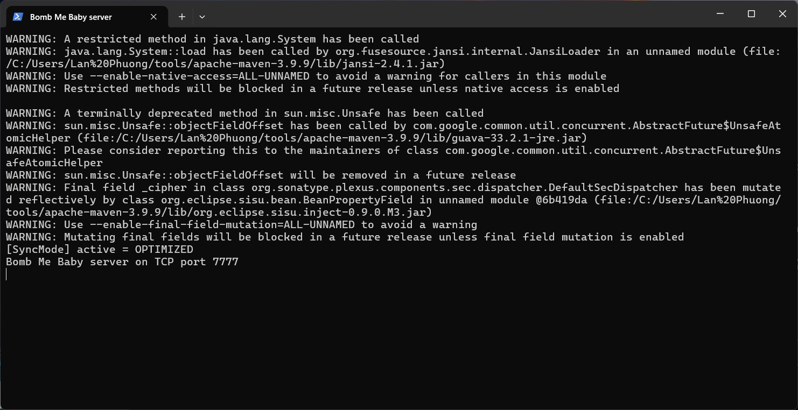
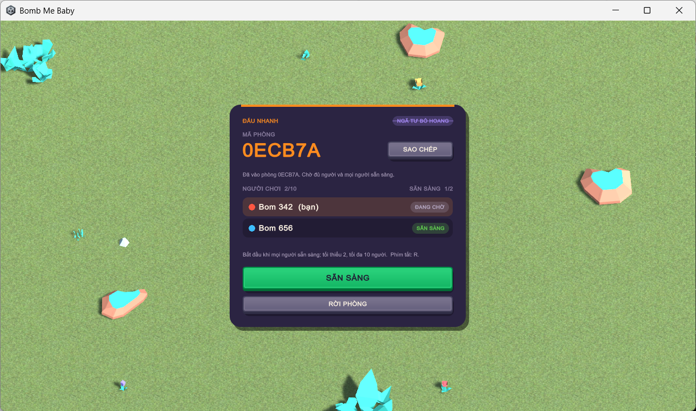
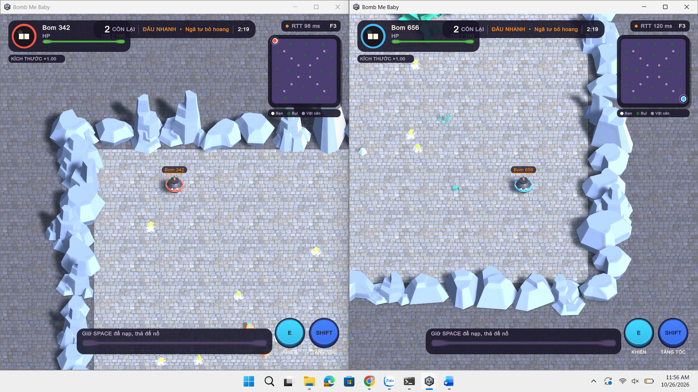
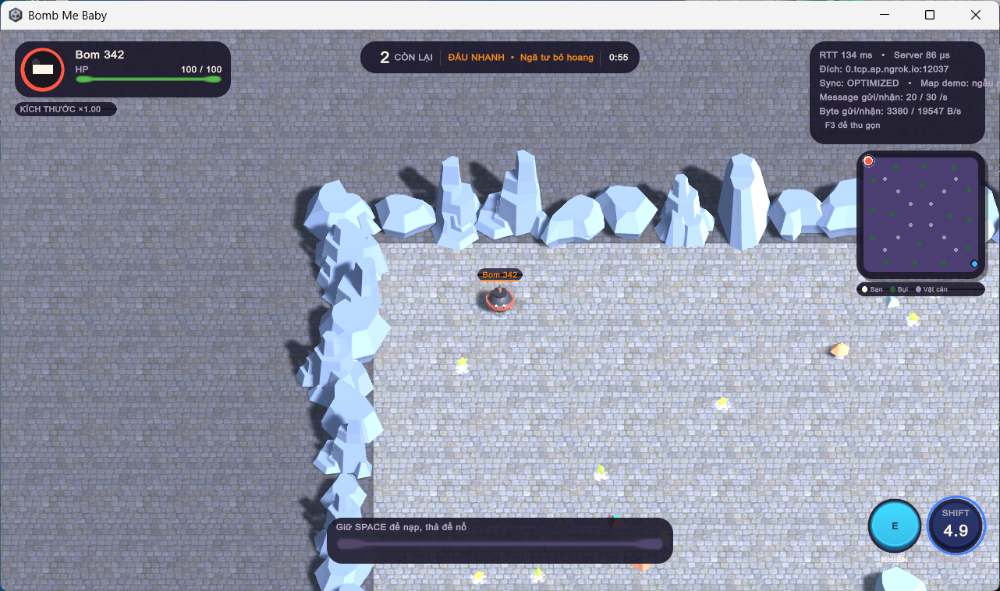
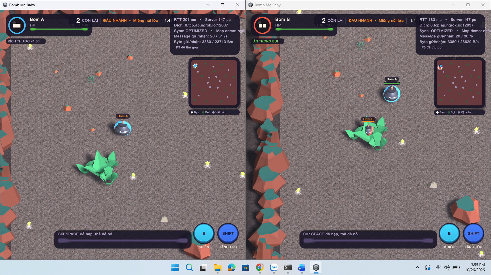

# 💣 Bomb Me Baby – NETWORK PROGRAMMING – FINAL PROJECT

> **Academic Year 2026–2027**

---

# 1. Project Information

## 1.1. Project Name

**Bomb Me Baby** – game đấu trường PvP 2.5D nhiều người chơi qua mạng TCP, server quyết định luật chơi và đồng bộ trạng thái chọn lọc.

## 1.2. Topic

**Chủ đề 2 – Phát triển game mạng**

## 1.3. Group

Nhóm 07.

| No. | Student ID | Full Name | Email | Main Responsibility | Contribution |
| --- | ---------- | --------- | ----- | ------------------- | -----------: |
| 1 | B23DCCN954 | Phạm Văn Vỹ (trưởng nhóm) | ... | Prototype server và client ban đầu; Unity client (menu, HUD, minimap, lời dẫn, màn kết quả); luật Mảnh Tim Lửa; kiểm tra phiên bản; hoàn thiện gameplay bản cuối | ...% |
| 2 | B23DCCN814 | Giang Thủy Tiên | ... | Đồng bộ chọn lọc (novelty); reconnect, heartbeat, timeout, hàng đợi ghi; chế độ Đấu nhanh và Hành trình; test JUnit, kiểm tra Unity; âm thanh | ...% |
| 3 | B23DCCN667 | Trần Đỗ Lan Phương | ... | Ghép trận `FIND_MATCH`; công cụ đo và thực nghiệm baseline/optimized; bản đồ và giao diện bằng asset; Khóa Lửa; bot test; viết báo cáo | ...% |
| | | | | **Total** | **100%** |

## 1.4. Instructor

**Thầy Ngô Văn Quyền**

Repository: https://github.com/VyOZzz/-LTM-Bomb-Me-Baby

---

# 2. Project Summary

## 2.1. Problem

Trong game hành động nhiều người, mọi máy phải thấy cùng một trận đấu dù độ trễ mỗi máy khác nhau và kết nối có thể đứt bất kỳ lúc nào. Bài toán là xây dựng một hệ thống client/server cho game đấu trường 2–10 người, trong đó server giữ trạng thái chính thức, phục vụ đồng thời nhiều phòng và nhiều kết nối, chịu được request trùng, client im lặng và mất kết nối tạm thời, đồng thời giảm được lượng dữ liệu đồng bộ so với cách gửi toàn bộ trạng thái.

## 2.2. Motivation

1. **Nhất quán và chống gian lận.** Nếu client tự quyết định HP hoặc người thắng, mỗi máy có thể ra một kết quả khác nhau và người chơi có thể sửa client để gian lận.
2. **Băng thông.** Bản đồ có nhiều đá và bụi không đổi trong suốt trận. Gửi lại chúng trong mọi snapshot là lãng phí, và lượng dữ liệu tăng theo số người chơi.
3. **Lộ thông tin.** Game có bụi để ẩn nấp. Nếu snapshot vẫn chứa tọa độ người trong bụi thì client bị sửa có thể nhìn xuyên bụi (map hack).

## 2.3. Objectives

Project hướng tới các mục tiêu:

1. Xây dựng server TCP giữ trạng thái chính thức của trận, phục vụ nhiều phòng và nhiều client đồng thời.
2. Thiết kế protocol JSON rõ ràng, có `seq` chống request trùng, heartbeat, timeout, reconnect và kiểm tra phiên bản.
3. Đề xuất cơ chế đồng bộ trạng thái chọn lọc và đo mức giảm băng thông so với baseline gửi toàn bộ.

## 2.4. Scope

### In scope

* Hai chế độ chơi: Đấu nhanh và Hành trình Tim Lửa; ba bản đồ.
* Phòng riêng bằng mã 6 ký tự, ghép trận ngẫu nhiên, tối đa 10 người mỗi phòng.
* Reconnect trong 10 giây bằng resume token; kiểm tra phiên bản client khi kết nối.
* Unity client cho Windows; Java server chạy trên mọi máy có Java 17+.
* Bộ công cụ đo baseline/optimized và bộ test JUnit.

### Out of scope

* Tài khoản, đăng nhập.
* Mã hóa TLS.
* Lưu lịch sử trận vào database.
* Chống gian lận toàn diện phía client.

---

# 3. System Overview

## 3.1. System Description

Người chơi điều khiển một quả bóng lăn trên bản đồ, nhặt Energy để lớn lên, gồng bom rồi tự kích nổ để hạ đối thủ. Toàn bộ luật chơi do Java server quyết định (server-authoritative). Unity client chỉ gửi ý định điều khiển (hướng di chuyển, gồng bom, kích nổ…) và hiển thị trạng thái server gửi về. Server mô phỏng ở 20 Hz, gửi snapshot ở 10 Hz, và mỗi snapshot được tạo riêng cho từng người xem: đối thủ ở xa hoặc trong bụi không được gửi tọa độ.

## 3.2. Target Users

* Người chơi trên máy Windows muốn chơi cùng bạn bè trong cùng mạng LAN, hoặc qua Internet khi server có IP public.
* Giảng viên và sinh viên môn Lập trình mạng, dùng project làm ví dụ về server-authoritative game, protocol tự thiết kế và đo đạc đồng bộ trạng thái.

## 3.3. Main Functions

| Function | Description | Status |
| -------- | ----------- | ------ |
| Kết nối và phiên | `HELLO`/`WELCOME`, cấp `playerId` và resume token, kiểm tra `protocolVersion` | Done |
| Phòng riêng | Tạo phòng, vào bằng mã 6 ký tự, bắt đầu khi tất cả bấm Sẵn sàng | Done |
| Ghép trận | Hàng đợi theo chế độ: đủ 4 người thì vào ngay, nhóm 2–3 người vào sau 15 giây đếm ngược | Done |
| Đấu nhanh | 3 phút, người sống cuối cùng thắng; hết giờ xếp hạng theo điểm hạ và sát thương | Done |
| Hành trình Tim Lửa | 3 chương trên 3 bản đồ, tranh Mảnh Tim Lửa và giữ bệ 30 giây | Done |
| Đồng bộ chọn lọc | Snapshot riêng cho từng người xem, chuyển được giữa `BASELINE` và `OPTIMIZED` | Done |
| Reconnect | Giữ chỗ 10 giây, khôi phục phòng, snapshot đầy đủ hoặc kết quả trận | Done |
| Heartbeat, timeout, chống quá tải | Đóng kết nối im lặng, ghi treo, frame quá lớn, hàng đợi đầy; tối đa 64 kết nối | Done |
| Bot và công cụ đo | Bot thêm người chơi, client giả lập đo RTT và băng thông | Done |
| Tài khoản, lịch sử trận | Không thuộc phạm vi | Not planned |

---

# 4. System Architecture

## 4.1. Architecture Diagram


Sơ đồ triển khai (deployment diagram) UML. Mỗi máy người chơi chạy Unity client và giữ một kết nối TCP tới máy chủ. Trên máy chủ, luồng đọc của từng `Connection` chuyển request vào `GameRoom` dưới khóa phòng; `GameLoop` cập nhật trạng thái 20 lần mỗi giây, tạo snapshot riêng cho từng người xem theo `SyncMode` rồi đưa vào hàng đợi ghi của từng kết nối.

## 4.2. Components

| Component | Responsibility |
| --------- | -------------- |
| Client (Unity: `BombGame`, `BombNetwork`) | Đọc input, gửi ý định điều khiển, nhận snapshot, nội suy vị trí đối thủ, hiển thị HUD, camera, âm thanh. Socket TCP chạy trên luồng nền, main thread chỉ đọc inbox |
| Server (`BombServer`, `Connection`) | Lắng nghe cổng 7777, đọc frame JSON, kiểm tra phiên bản và `seq`, quản lý phiên và resume token |
| Database | Không có. Trạng thái phòng và phiên nằm trong bộ nhớ vì không có tài khoản hay lịch sử trận |
| Service (`Matchmaker`, `SyncMode`, `GameRoom`, `ShardObjective`) | Ghép trận theo chế độ; chọn chế độ đồng bộ; mô phỏng trận, luật chiến đấu và mục tiêu Hành trình |
| Worker (game loop, luồng ghi) | Một luồng game loop chạy mỗi 50 ms; mỗi kết nối có một luồng đọc từ thread pool (64) và một luồng ghi riêng với hàng đợi tối đa 128 message |

## 4.3. Data Flow


1. Client đọc phím, dự đoán ngay vị trí nhân vật của mình và gửi `MOVE` mỗi 40 ms, mỗi request có `seq` tăng dần.
2. Luồng đọc của server đọc frame (tối đa 2048 ký tự), parse JSON, bỏ request có `seq` không tăng, rồi gọi `GameRoom.action()` dưới khóa phòng. Với `MOVE`, server chỉ ghi lại hướng và trả `ACK`.
3. Game loop mỗi 50 ms di chuyển nhân vật, xử lý va chạm, nhặt đồ, nổ bom và điều kiện kết thúc; event như nổ bom được đưa vào hàng đợi ghi ngay khi xảy ra.
4. Cứ hai tick (100 ms), server tạo snapshot riêng cho từng người xem, lọc theo `SyncMode`, và luồng ghi của từng kết nối gửi đi ngoài khóa phòng.
5. Client đọc từng dòng vào inbox; main thread bỏ snapshot sai phòng hoặc sai vòng, rồi kéo nhân vật của mình về vị trí server, nội suy đối thủ, ẩn người có `visible=false` và cập nhật HUD.

---

# 5. Network Communication Design

## 5.1. Communication Model

```text
Unity Client 1 ─┐
Unity Client 2 ─┼── TCP, kết nối giữ suốt phiên chơi, JSON mỗi dòng ──► Java Server (cổng 7777)
Unity Client N ─┘                                                       (trạng thái trong bộ nhớ, không có database)
```

## 5.2. Protocol

**Protocol:** TCP với custom protocol: mỗi message là một JSON object trên một dòng UTF-8, kết thúc bằng LF hoặc CRLF, tối đa 2048 ký tự. Cổng mặc định 7777.

## 5.3. Message Format

```json
{"type":"HELLO","protocolVersion":1,"name":"Bom A","resumeToken":""}
{"type":"WELCOME","playerId":"...","resumeToken":"...","syncMode":"OPTIMIZED","demoMap":""}
{"type":"CREATE_ROOM","seq":1,"mode":"QUICK"}
{"type":"JOIN_ROOM","seq":2,"code":"ABC123"}
{"type":"FIND_MATCH","seq":3,"mode":"JOURNEY"}
{"type":"MOVE","seq":4,"directionX":0.8,"directionZ":0.3}
{"type":"ACK","seq":4,"processingMicros":31}
{"type":"PING","clientTime":1720000000000}
{"type":"ERROR","code":"DUPLICATE_SEQUENCE"}
{"type":"ERROR","code":"VERSION_MISMATCH","serverVersion":1}
```

Trừ `HELLO` và `PING`, mọi request phải có `seq` lớn hơn mọi `seq` server đã nhận trong cùng phiên; `seq` không reset khi đổi phòng hay reconnect. `protocolVersion` của client phải bằng `BombServer.PROTOCOL_VERSION`.

## 5.4. Communication Sequence

Trình tự một trận phòng riêng (sequence diagram UML):


Trình tự mất kết nối và kết nối lại:


## 5.5. Error Handling

| Tình huống | Cách xử lý |
| --- | --- |
| Invalid request (sai thứ tự, sai trạng thái) | `HELLO_REQUIRED`, `NOT_IN_ROOM`, `ACTION_UNAVAILABLE`, `ROOM_UNAVAILABLE`, `BOMB_COOLDOWN`, `ALREADY_SEARCHING`, `INVALID_MODE`; giữ kết nối |
| Request trùng hoặc cũ | `seq` không tăng → `DUPLICATE_SEQUENCE`, không thực hiện lại |
| Lệch phiên bản | `protocolVersion` thiếu hoặc khác server → `VERSION_MISMATCH`, không tạo phiên; client ngừng kết nối lại và báo cập nhật bản mới |
| Invalid data (JSON sai, thiếu trường) | `ERROR INVALID_MESSAGE`, frame sau vẫn được xử lý bình thường |
| Frame quá lớn | Đóng socket khi vượt 2048 ký tự, kể cả khi chưa gặp newline |
| Timeout | Server đóng kết nối sau 6 giây không nhận message hợp lệ; client tự đóng sau 7 giây rồi thử kết nối lại |
| Ghi bị treo, client chậm | Đóng kết nối nếu một lần ghi quá 3 giây hoặc hàng đợi ghi đầy 128 message |
| Disconnect | Giữ chỗ 10 giây; client gửi lại `HELLO` kèm `resumeToken`; quá hạn thì người chơi bị loại |
| Server error | Lỗi khi cập nhật một phòng hoặc khi ghép trận được bắt và ghi log, game loop và các phòng khác vẫn chạy |
| Database error | Không áp dụng vì hệ thống không dùng database |
| Quá tải | Từ chối kết nối thứ 65 trở đi |
| Input cũ | Hướng di chuyển tự về 0 sau 0,5 giây nếu không có `MOVE` mới |

---

# 6. Technology Stack

| Category | Technology |
| ---------- | -------------------- |
| Language | Java 17 (server), C# (Unity client), Python 3 và PowerShell (script đo, test) |
| Network | TCP: `java.net.ServerSocket`/`Socket` (server), `System.Net.Sockets.TcpClient` (client) |
| Database | Không dùng |
| Framework, thư viện | Unity 6.3 LTS (`6000.3.6f1`); Gson 2.11 (server); `JsonUtility` của Unity (client); JUnit 5.11 (test) |
| Build Tool | Maven 3.9 (server), Unity batch build qua `scripts/build_client.ps1` (client) |
| IDE | Unity Editor, Visual Studio Code |
| OS | Windows 10/11 64-bit |

Tài nguyên đồ họa và âm thanh: asset CC0 của Kenney, ambientCG và OpenGameArt; nguồn và giấy phép trong [docs/ASSET_CREDITS.md](docs/ASSET_CREDITS.md) và [docs/AUDIO_CREDITS.md](docs/AUDIO_CREDITS.md).

---

# 7. Novelty and Contributions

## 7.1. Baseline

Bản prototype ban đầu (commit `aaed786`, 12/10/2026) gửi snapshot đầy đủ cho mọi người: toàn bộ hình học bản đồ, toàn bộ vật phẩm và tọa độ của mọi người chơi, 10 lần mỗi giây. Bản này chưa có reconnect, chưa chống request trùng và chưa có ghép trận. Chế độ `BASELINE` hiện tại giữ đúng cách gửi đầy đủ này để làm mốc so sánh trên cùng luật chơi.

## 7.2. Proposed Improvement

* **Đồng bộ trạng thái chọn lọc (`OPTIMIZED`):** hình học tĩnh chỉ gửi một lần ở `GAME_START` hoặc khi reconnect; vật phẩm và đối thủ chỉ được gửi khi người xem được phép thấy (bán kính nhìn 26 đơn vị, bụi); event nổ không có tọa độ với người không thấy nguồn nổ.
* **Phục hồi phiên giữ đúng thứ tự vòng đời trận:** resume token, `seq` không reset, `roomCode` và `roundIndex` trong snapshot, phát lại kết quả khi reconnect sau trận.
* **Concurrency có kiểm soát:** thứ tự khóa cố định `player → room → hàng đợi ghi`, hàng đợi ghi riêng cho từng client, watchdog ghi treo, ticket ghép trận có generation.
* **Game do nhóm tự nghĩ và phát triển:** nhân vật chính là quả bom, gồng lực rồi tự nổ quanh mình; Size vừa là sức mạnh vừa là thứ phải tiêu và rơi lại cho đối thủ; chế độ Hành trình Tim Lửa có luật tranh mảnh riêng (Khóa Lửa, cướp mảnh trên bệ).

## 7.3. Contributions

| No. | Contribution | Description | Evidence |
| --- | ------------ | ----------- | -------- |
| 1 | Đồng bộ trạng thái chọn lọc | Snapshot riêng cho từng người xem, bỏ hình học tĩnh, lọc vật phẩm và đối thủ theo tầm nhìn và bụi | `SyncMode.java`, `GameRoom.snapshot(...)`; giảm 62,0–77,8% byte nhận mỗi client (mục 14); test `optimizedHidesBushOpponentButShowsSelfAndSameBush` |
| 2 | Phục hồi phiên giữ thứ tự vòng đời | Resume token, `seq` không reset, phát lại `GAME_OVER` khi reconnect sau trận | `BombServer.java`; `ConnectionTest`, `CompletionRegressionTest` |
| 3 | Concurrency có kiểm soát | Thứ tự khóa cố định, hàng đợi ghi giới hạn 128, watchdog ghi treo, ticket ghép trận có generation | `BombServer.java`, `Matchmaker.java`; test `watchdogDoesNotMisreadAWriteFinishingBetweenVolatileReads`, `concurrentCancelAndCommitHaveOneOutcomeWithoutDeadlock` |
| 4 | Bộ công cụ đo lặp lại được | Client giả lập, runner ma trận baseline/optimized, fingerprint mã nguồn, giữ cả lượt đo lỗi | `scripts/load_test.py`, `scripts/run_benchmark.ps1`, `experiments/` |
| 5 | Game và cơ chế chơi tự thiết kế | Người chơi là quả bom, Size vừa là sức mạnh vừa là thứ phải tiêu, khiên phản đòn, chế độ Hành trình có Khóa Lửa và cướp mảnh | `GameRules.java`, `ShardObjective.java`; `GameRoomTest`, `ShardStealMechanicsTest` |

## 7.4. Baseline vs Proposed

| Aspect | Baseline | Proposed |
| ------------- | -------- | -------- |
| Architecture | Server-authoritative, một snapshot giống nhau cho cả phòng | Server-authoritative, snapshot riêng cho từng người xem |
| Algorithm | Gửi toàn bộ trạng thái mỗi 100 ms | Lọc theo bán kính nhìn và bụi; hình học tĩnh chỉ gửi một lần |
| Communication | Hình học, mọi vật phẩm và tọa độ mọi người trong mọi snapshot | Chỉ dữ liệu người xem được phép thấy; event nổ ẩn tọa độ khi không thấy nguồn |
| Performance (8 client) | 116 644 byte nhận/client/giây | 44 365 byte nhận/client/giây (giảm 62,0%) |
| Functionality | Client nhận được vị trí đối thủ đang ẩn | Chống map hack ngay từ dữ liệu gửi đi |

---

# 8. Project Structure

```text
-LTM-Bomb-Me-Baby/
│
├── README.md                      ← file này
│
├── docs/
│   ├── DEMO_RUNBOOK.md            ← kịch bản demo
│   ├── images/                    ← sơ đồ kiến trúc, luồng, sequence và ảnh chạy thực tế
│   └── ...                        ← GDD, nguồn asset và âm thanh
│
├── experiments/                   ← dữ liệu đo thô (CSV) và bảng tổng hợp
│
├── server/                        ← Java server (Maven)
│   ├── pom.xml
│   └── src/
│       ├── main/java/bombmebaby/  ← BombServer, GameRoom, Matchmaker, SyncMode, ShardObjective, GameRules, GameMap
│       └── test/java/bombmebaby/  ← 9 lớp test JUnit
│
├── LTM-Bomb-Me-Baby/              ← project Unity (client)
│   ├── Assets/Scenes/Main.unity
│   ├── Assets/Scripts/            ← BombNetwork, BombGame, BombProtocol, HUD, menu, bản đồ, âm thanh
│   ├── Assets/Editor/             ← công cụ build, kiểm tra, dựng scene
│   └── Assets/StreamingAssets/    ← phim mở đầu, lời dẫn
│
├── scripts/                       ← chạy server, build client, bot, smoke test, đo đạc, đóng gói
└── builds/                        ← bản build (bị Git bỏ qua, tạo bằng script)
```

---

# 9. Requirements

## Hardware

| | Tối thiểu | Máy nhóm dùng để đo (25/10/2026) |
| --- | --- | --- |
| CPU | 4 nhân | 13th Gen Intel Core i9-13900H |
| RAM | 8 GB (16 GB nếu mở Unity Editor) | 16 GB |
| Disk | ~1 GB cho bản build; ~10 GB nếu cài Unity Editor | |
| Mạng | Cùng LAN, hoặc server có IP public/port forwarding | Loopback |

## Software

* OS: Windows 10/11 64-bit.
* Java: JDK 17 trở lên (chạy server).
* Maven: 3.9 trở lên (build và test server từ source).
* Database: không cần.
* Other dependencies:
  * Unity Hub và Unity Editor `6000.3.6f1`, chỉ cần khi mở, sửa hoặc build client từ source;
  * Python 3.10 trở lên để chạy bot, smoke test và benchmark (chỉ dùng thư viện chuẩn);
  * Git để clone source.

> Chỉ chơi thì **không cần** cài Unity: chỉ cần bản build Windows và một máy chạy server có Java 17.

---

# 10. Installation

## 10.1. Clone / Download

```bash
git clone https://github.com/VyOZzz/-LTM-Bomb-Me-Baby.git
cd -LTM-Bomb-Me-Baby
```

hoặc download source code từ Google Drive (thư mục `Nhom07_BombMeBaby_Source/`).

## 10.2. Install Dependencies

```powershell
java -version      # phải là 17 trở lên
mvn -v
python --version
cd server
mvn package        # Maven tự tải Gson và JUnit, build JAR và chạy test
```

Client không cần cài thêm thư viện. Muốn build client từ source thì cài Unity `6000.3.6f1` qua Unity Hub.

## 10.3. Database Setup

Không cần. Server giữ trạng thái phòng và phiên trong bộ nhớ, không có database hay schema.

## 10.4. Configuration

**Server:**

| Tham số | Mặc định | Ý nghĩa |
| --- | --- | --- |
| Đối số đầu tiên | `7777` | Cổng TCP |
| `-Dsync.mode` | `baseline` khi chạy trực tiếp; `optimized` khi chạy bằng `scripts/run_server.ps1` | Chế độ đồng bộ |
| `-Ddemo.map` hoặc biến môi trường `DEMO_MAP` | rỗng (ngẫu nhiên) | Khóa bản đồ Đấu nhanh khi demo: `meadow`, `crossroads`, `crater` |

**Client** chỉ định server bằng một trong ba cách:

* file `server.txt` cạnh file `.exe`, dòng đầu là `HOST:PORT`, ví dụ `192.168.1.20:7777`;
* tham số dòng lệnh `--server=192.168.1.20:7777`;
* nhập trong game ở mục **Cài đặt mạng nâng cao** (client nhớ địa chỉ đã nhập).

Mặc định client kết nối `127.0.0.1:7777`.

---

# 11. Running the Project

## 11.1. Start Server

```powershell
# Cách khuyên dùng: tự build JAR rồi chạy ở chế độ optimized
powershell -ExecutionPolicy Bypass -File scripts/run_server.ps1
# Tùy chọn: -Port 7777  -SyncMode optimized|baseline  -DemoMap meadow|crossroads|crater

# Hoặc chạy JAR đã build (máy chạy chỉ cần Java)
cd server
java -Dsync.mode=optimized -jar target/bomb-me-baby-server-1.0.0.jar 7777
```

Khi thấy dòng `Bomb Me Baby server on TCP port 7777` là server đã sẵn sàng.

## 11.2. Start Client

```powershell
# Build bản Windows từ source (kết quả: builds/windows/BombMeBaby.exe)
powershell -ExecutionPolicy Bypass -File scripts/build_client.ps1 -Isolated

# Chạy client
builds\windows\BombMeBaby.exe
# Hoặc chỉ định server: builds\windows\BombMeBaby.exe --server=192.168.1.20:7777
```

Khi gửi bản build cho người khác, phải gửi **cả thư mục** `builds/windows/`, không chỉ file `.exe`. Có thể chạy từ Unity Editor: mở thư mục `LTM-Bomb-Me-Baby/` trong Unity Hub, mở `Assets/Scenes/Main.unity` rồi nhấn **Play**.

Trong game: nhập tên → chọn chế độ → **TÌM TRẬN**, **TẠO PHÒNG RIÊNG** hoặc **VÀO PHÒNG BẠN BÈ**.

## 11.3. Start Multiple Clients

```powershell
# Cùng một máy: mở nhiều cửa sổ, tất cả dùng 127.0.0.1:7777
Start-Process builds\windows\BombMeBaby.exe
Start-Process builds\windows\BombMeBaby.exe

# Thiếu người: thêm bot tìm trận hoặc vào phòng có mã
python scripts/bots.py --find QUICK --count 2
python scripts/bots.py --room ABC123 --count 3
```

Chơi qua LAN: chạy server trên một máy, lấy IPv4 bằng `ipconfig`, mở firewall cho TCP 7777 (PowerShell quyền Administrator: `New-NetFirewallRule -DisplayName "Bomb Me Baby" -Direction Inbound -Protocol TCP -LocalPort 7777 -Action Allow`), các máy khác nhập địa chỉ đó. Kiểm tra kết nối bằng `Test-NetConnection <IP> -Port 7777`.

## 11.4. Run Test

```powershell
cd server
mvn test "-Dsync.mode=baseline"     # 117 test JUnit
mvn test "-Dsync.mode=optimized"    # chạy lại toàn bộ test ở chế độ optimized
cd ..
python scripts/network_smoke.py     # smoke test qua TCP thật với 2 client giả lập (server phải đang chạy)
```

---

# 12. Main Features

| No. | Feature | Description | Test |
| --- | ------- | ----------- | ------ |
| 1 | Kết nối, phiên, phiên bản | `HELLO` bắt buộc trước mọi request; lệch hoặc thiếu `protocolVersion` bị từ chối | Passed (`helloRequiredBeforeRoomActions`, `mismatchedOrMissingProtocolVersionIsRejected`) |
| 2 | Chống request trùng | Request có `seq` trùng hoặc cũ không làm đổi phòng hay hướng di chuyển | Passed (`duplicateAndOlderRequestsDoNotChangeRoomOrMovement`) |
| 3 | Phòng riêng | Tạo, vào, rời phòng; chỉ bắt đầu khi đủ 2 người và tất cả sẵn sàng | Passed (`requiresTwoReadyPlayersAndResetsRound`, `leaveRoomClearsMembershipAndAllowsCreatingAnotherRoom`) |
| 4 | Ghép trận | Đủ 4 người thì vào ngay, 2–3 người vào sau 15 giây đếm ngược; không trộn chế độ, hủy tìm an toàn | Passed (`fullQueueMatchesAtOnceAndModesNeverMix`, `twoSearchingPlayersWaitForCountdownThenStartWithoutReady`, `countdownStartsWhenTheSecondPlayerJoinsAndExtraPlayersKeepWaiting`) |
| 5 | Reconnect | Khôi phục danh tính, `seq`, phòng và bản đồ; từ chối khi quá hạn | Passed (`resumeRestoresIdentitySequenceRoomAndFullMap`, `resumeAtOrAfterDeadlineIsRejected`) |
| 6 | Heartbeat, frame, hàng đợi ghi | Đóng kết nối im lặng; frame quá lớn; gộp snapshot nhưng giữ event | Passed (`heartbeatWatchdogClosesASilentConnection`, `oversizedUnterminatedFrameClosesWithoutWaitingForNewline`, `outboundQueueCoalescesSnapshotsButKeepsEvents`) |
| 7 | Đồng bộ chọn lọc | Ẩn đối thủ ở xa và trong bụi, bỏ hình học tĩnh, snapshot ít byte hơn | Passed (`optimizedHidesBushOpponentButShowsSelfAndSameBush`, `optimizedHidesDistantOpponent`, `optimizedSnapshotUsesFewerUtf8BytesForIdenticalState`) |
| 8 | Luật chiến đấu | Sát thương 80 HP khi gồng đầy, khiên phản đòn, nổ trả Size thành Energy | Passed (`fullChargeExplosionActuallyRemovesEightyHp`, `shieldReflectsAndDoesNotDamageTarget`, `explosionDropsSpentSizeAsEnergyFragments`) |
| 9 | Đấu nhanh | Hết giờ xếp hạng theo điểm hạ rồi sát thương; 60 giây cuối lộ vị trí trên minimap | Passed (`quickTimeoutRanksKillsThenDamageAndCrownsTheLeader`, `finalQuickMinuteRevealsEveryPositionForTheMinimapOnly`) |
| 10 | Hành trình Tim Lửa | Giữ bệ 30 giây để thắng, Khóa Lửa, cướp mảnh, chạy đủ 3 bản đồ | Passed (`placedShardOwnerWinsExactlyAfterThirtyUncontestedSeconds`, `lockRegeneratesGraduallyAfterDelayAndDropsShardWhenEmpty`, `journeyRunsAllThreeMapsAndCompletesWithItsWinner`) |

Toàn bộ 117 test qua ở cả `baseline` và `optimized` (chạy lại ngày 26/10/2026).

---

# 13. Experimental Setup

## 13.1. Environment

| Mục | Giá trị |
| --- | --- |
| Phần cứng | 13th Gen Intel Core i9-13900H, RAM 16 GB |
| Hệ điều hành | Windows 11 Home Single Language (build 26200) |
| Công cụ | Java 26.0.2 (target Java 17), Maven 3.9.9, Python 3.13.14 |
| Mã nguồn đo | Commit `c35616f`, đo ngày 25/10/2026 |
| Mạng | Loopback `127.0.0.1:17777` |
| Bản đồ, chế độ | `meadow` cố định, Đấu nhanh |
| Input giả lập | `MOVE` 10 Hz, `PING` 1 Hz, không nổ bom |

## 13.2. Dataset

Không dùng dataset có sẵn. Dữ liệu được sinh bởi client giả lập `scripts/load_test.py` với seed 1, 2, 3. Dữ liệu thô của 18 lượt đo nằm trong `experiments/final-2026-10-25/`; lần đo đối chứng ngày 22/10 trên máy khác nằm trong `experiments/final-2026-10-22-v2/`.

## 13.3. Test Scenarios

Mỗi kịch bản chạy ở cả `baseline` và `optimized`, mỗi chế độ 3 lượt × 30 giây (tổng 18 lượt). Server được khởi động lại khi đổi chế độ; số đo tính từ sau `GAME_START` đến trước khi đóng kết nối.

### Scenario 1

2 client giả lập trong cùng một trận.

### Scenario 2

4 client giả lập trong cùng một trận.

### Scenario 3

8 client giả lập trong cùng một trận.

## 13.4. Evaluation Metrics

Các metric sử dụng:

* Byte nhận mỗi client mỗi giây (băng thông);
* Byte mỗi snapshot;
* Response time: RTT trung bình và p95 đo bằng `PING`/`PONG`;
* Server processing time: `processingMicros` trong `ACK`;
* Error rate: số `ERROR` và `CONNECTION_LOST`;
* Concurrent users: 2, 4 và 8 client.

Số byte tính theo JSON UTF-8 cộng newline, không gồm overhead TCP/IP. Chạy lại toàn bộ:

```powershell
powershell -ExecutionPolicy Bypass -File scripts/run_benchmark.ps1 -Duration 30 -Repeats 3 -Map meadow -OutDir experiments/final-2026-10-25
python scripts/summarize_experiments.py --summary experiments/final-2026-10-25/summary.csv
```

---

# 14. Experimental Results

## 14.1. Functional Results

Java server chạy ở chế độ `OPTIMIZED`:



Sảnh phòng riêng với mã phòng do server cấp:



Hai client trong cùng một trận thấy cùng vị trí, HP và đồng hồ:



HUD và bảng debug F3 (địa chỉ server, chế độ đồng bộ, RTT):



Đồng bộ chọn lọc: Bom B nấp trong bụi nên không xuất hiện trên màn hình Bom A ở bên ngoài, vì server không gửi tọa độ của B cho A:



## 14.2. Performance Results

Trung bình 3 lượt mỗi cấu hình; 18/18 lượt hoàn tất, 0 `ERROR`, 0 `CONNECTION_LOST`.

| Scenario | Chế độ | Byte nhận/client/s | Byte/snapshot | RTT TB (ms) | RTT p95 (ms) | processingMicros TB (µs) |
| ---------- | --- | -------: | -------: | -------: | -------: | -------: |
| Scenario 1 (2 client) | baseline | 95 981,8 | 9 511,4 | 0,668 | 1,501 | 160,7 |
| Scenario 1 (2 client) | optimized | 21 316,2 | 2 068,5 | 0,765 | 2,038 | 182,1 |
| Scenario 2 (4 client) | baseline | 102 304,8 | 10 140,6 | 0,402 | 0,905 | 68,8 |
| Scenario 2 (4 client) | optimized | 28 005,9 | 2 735,2 | 0,429 | 0,919 | 65,1 |
| Scenario 3 (8 client) | baseline | 116 644,1 | 11 570,5 | 0,447 | 0,968 | 51,9 |
| Scenario 3 (8 client) | optimized | 44 364,9 | 4 362,3 | 0,414 | 0,939 | 50,7 |

## 14.3. Comparison

| Metric | Baseline | Proposed | Difference |
| ------ | -------: | -------: | ---------: |
| Byte nhận/client/s, 2 client | 95 981,8 | 21 316,2 | −77,8% |
| Byte nhận/client/s, 4 client | 102 304,8 | 28 005,9 | −72,6% |
| Byte nhận/client/s, 8 client | 116 644,1 | 44 364,9 | −62,0% |
| Byte/snapshot, 8 client | 11 570,5 | 4 362,3 | −62,3% |
| RTT TB, 8 client (ms) | 0,447 | 0,414 | không khác biệt đáng kể |

Lần đo ngày 22/10 trên máy khác (i7-11800H, Java 21) cho tỉ lệ giảm gần như trùng: 78,1% / 74,3% / 62,1%.

> **Only report measured or reproducible results. Do not fabricate experimental data.**

---

# 15. Discussion

1. **Kết quả có đạt mục tiêu không?** Có. Chế độ chọn lọc giảm 62,0–77,8% byte mỗi client nhận trong một giây, không có lỗi kết nối, và 117 test chức năng đều qua ở cả hai chế độ.
2. **Vì sao có kết quả như vậy?** Với 2 client, snapshot baseline nặng khoảng 9 500 byte, còn optimized khoảng 2 100 byte. Phần chênh lệch là hình học tĩnh của bản đồ cùng vật phẩm và đối thủ ngoài tầm nhìn, vốn bị gửi lại 10 lần mỗi giây ở baseline. Số message không đổi; cải tiến làm nhỏ từng message chứ không giảm số lần gửi.
3. **Khi tăng số client thì sao?** Mức giảm nhỏ dần từ 78% xuống 62%. Phần tiết kiệm từ hình học là cố định, còn trạng thái động tăng theo số người; với 8 người trên cùng bản đồ, nhiều người đứng gần nhau hơn nên vẫn phải gửi cho nhau.
4. **Bottleneck nằm ở đâu?** CPU server chưa phải điểm nghẽn: mỗi request được xử lý trong vài chục micro giây. Trên mạng thật, băng thông uplink của máy chạy server mới là giới hạn: baseline 8 người cần khoảng 0,93 MB/s chỉ cho snapshot, optimized khoảng 0,35 MB/s.
5. **Ưu điểm của giải pháp:** giảm băng thông mà không làm tăng độ trễ đo được, đồng thời chặn map hack ngay từ dữ liệu gửi đi vì client không nhận tọa độ người trong bụi.
6. **Hạn chế của giải pháp:** khi người chơi tập trung một chỗ thì việc lọc ít tác dụng; khi mạng mất gói nhiều thì TCP chặn đầu hàng gây giật hình; trên loopback, RTT chủ yếu phản ánh lịch luồng nên kết quả không chứng minh optimized giảm độ trễ.

---

# 16. Limitations

Các hạn chế hiện tại:

1. Benchmark chạy trên loopback với client giả lập, chưa đo trên LAN hoặc Internet thật, chưa đo FPS của client.
2. Dùng TCP thuần: chưa có TLS, đăng nhập hay lưu lịch sử trận; chống gian lận mới ở mức server bỏ qua input bất thường và request trùng.
3. Chưa có rate limit theo client.
4. Đồng bộ chọn lọc lọc theo người xem nhưng chưa nén delta từng trường giữa hai snapshot.
5. Client chỉ dự đoán hình ảnh ngắn hạn, chưa có lag compensation phía server.
6. Trạng thái nằm trong bộ nhớ; khởi động lại server thì mất mọi phòng.

---

# 17. Future Work

Các hướng phát triển:

1. Gửi delta giữa hai snapshot; cân nhắc UDP cho dữ liệu vị trí và giữ TCP cho event vòng đời trận.
2. Đo trên LAN hai máy và trên mạng có độ trễ, mất gói nhân tạo, với nhiều client hơn.
3. Thêm tài khoản, lưu kết quả trận vào database, bảng xếp hạng toàn cục.
4. Thêm TLS, rate limit và lag compensation phía server.
5. Thử Java NIO hoặc mô hình event loop khi số kết nối lớn.

---

# 18. Report

Báo cáo đầy đủ:

```text
Nhom07_BombMeBaby_Report.docx        ← file nộp, nằm trong thư mục Report/ của gói nộp bài
```

Báo cáo tuân thủ cấu trúc được quy định trong hướng dẫn đồ án (mục 8) và phải được kiểm tra bằng **Compilatio**.

> **Similarity ≤ 20% là yêu cầu đạt của học phần.**

---

# 19. References

Các tài liệu tham khảo được sử dụng (danh sách đầy đủ ở mục 17 của báo cáo):

1. W. Eddy (ed.), *Transmission Control Protocol (TCP)*, RFC 9293, IETF, 2022. https://www.rfc-editor.org/rfc/rfc9293.html
2. Oracle, *Java SE 17 API Specification – package java.net*. https://docs.oracle.com/en/java/javase/17/docs/api/java.base/java/net/package-summary.html
3. Unity Technologies, *Unity 6.3 Manual*. https://docs.unity3d.com/Manual/index.html
4. G. Fiedler, *Snapshot Interpolation*, Gaffer On Games, 2014. https://gafferongames.com/post/snapshot_interpolation/
5. Google, *Gson*. https://github.com/google/gson
6. The JUnit Team, *JUnit 5 User Guide*. https://junit.org/junit5/
7. P. Chamberlain, *Demolishing Wallhacks with VALORANT's Fog of War*, Riot Games, 2020. https://www.riotgames.com/en/news/demolishing-wallhacks-valorants-fog-war
8. G. Fiedler, *UDP vs. TCP*, Gaffer On Games, 2008. https://gafferongames.com/post/udp_vs_tcp/
9. Kenney, ambientCG, OpenGameArt: asset CC0 và CC-BY 4.0, ghi nguồn trong `docs/ASSET_CREDITS.md` và `docs/AUDIO_CREDITS.md`.

Các tài liệu được trích dẫn trong nội dung báo cáo khi sử dụng.

---

# 20. Team Contribution

| Student | Main Contribution | Percentage |
| --------- | ----------------- | ---------: |
| Phạm Văn Vỹ | Prototype server và Unity client ban đầu; menu, HUD, minimap, lời dẫn, màn kết quả; luật Mảnh Tim Lửa; bố cục bản đồ, bảng xếp hạng Đấu nhanh, kiểm tra phiên bản, ghép trận có đếm ngược | ...% |
| Giang Thủy Tiên | Đồng bộ chọn lọc `SyncMode`; reconnect, heartbeat, timeout, hàng đợi ghi, watchdog; chế độ Đấu nhanh và Hành trình; test JUnit, harness kiểm tra Unity; âm thanh | ...% |
| Trần Đỗ Lan Phương | Ghép trận `FIND_MATCH`/`CANCEL_MATCH`; công cụ đo và thực nghiệm; bản đồ, giao diện và VFX bằng asset; Khóa Lửa; bot test; viết báo cáo | ...% |
| **Total** | | **100%** |

Chi tiết từng phần việc: mục 19 của báo cáo.

---

# 21. Demo

## Demo Environment

* Server machine: một máy Windows chạy Java server (`scripts/run_server.ps1`, chế độ `optimized`, cổng 7777).
* Client machine(s): cùng máy server hoặc các máy Windows khác chạy `BombMeBaby.exe`.
* Network: loopback hoặc cùng LAN/Wi-Fi.
* Number of clients: 2–4 Unity client; có thể thêm bot bằng `scripts/bots.py`.

## Demo Steps

### Step 1

Chạy server, nhấn **F3** trong game để xác nhận địa chỉ server và chế độ `OPTIMIZED`. Muốn lặp lại cùng một bản đồ thì chạy server với `-DemoMap meadow`.

### Step 2

Client thứ nhất tạo phòng riêng, các client khác nhập mã phòng; kiểm tra mọi client thấy cùng mã phòng và danh sách người chơi. Tất cả bấm **SẴN SÀNG** để vào trận (phòng đang chơi sẽ từ chối người vào mới).

### Step 3

Trong trận: di chuyển bằng WASD, giữ rồi thả Space để nổ, dùng E (khiên) và Shift (tăng tốc). Đứng trong bụi để thấy đối thủ ở ngoài không nhìn thấy mình.

### Step 4

Tắt một client hoặc ngắt mạng dưới 10 giây rồi kết nối lại; kiểm tra người chơi giữ được danh tính, phòng và bản đồ. Quá 10 giây thì người đó bị loại.

### Step 5

Chơi Đấu nhanh tới hết 3 phút để xem bảng xếp hạng, rồi tạo phòng **Hành trình Tim Lửa** để demo tranh Mảnh Tim Lửa qua `meadow → crossroads → crater`.

Kịch bản chi tiết: [docs/DEMO_RUNBOOK.md](docs/DEMO_RUNBOOK.md).

---

# 22. Submission

## Source Code

Project source code được nộp thông qua **Google Drive** trong thư mục `Nhom07_BombMeBaby_Source/`.

**Submission link sẽ được giảng viên thông báo sau.**

## Report

```text
Nhom07_BombMeBaby_Report.docx
```

Gói bàn giao theo hướng dẫn nộp bài:

```text
Nhom07_BombMeBaby/
├── Source/      ← toàn bộ source code và tài liệu để chạy project
└── Report/      ← Nhom07_BombMeBaby_Report.docx đã nộp trên Compilatio
```

## Required Contents

* Source code: `server/`, `LTM-Bomb-Me-Baby/`, `scripts/`;
* README: file này;
* Report: `Nhom07_BombMeBaby_Report.docx`;
* Configuration: tham số server và `server.txt` của client (mục 10.4);
* Database script: không có (không dùng database);
* Dataset/sample data: `experiments/`;
* Test cases: `server/src/test/java/bombmebaby/`;
* Experimental results: `experiments/final-2026-10-25/`;
* Architecture diagrams: `docs/images/`.

---

# 23. Final Verification

Before submission:

```text
[x] Project can run
[x] Server can start
[x] Client can connect
[x] Network communication works
[x] Protocol is documented
[x] Multiple clients tested
[x] Error handling tested
[x] Experiments completed
[x] Results are reproducible
[x] Novelty is clearly stated
[x] README is complete
[ ] Report is complete            (còn ảnh Hình 10–13 và tỉ lệ đóng góp)
[x] References are included
[ ] Compilatio <= 20%
[ ] Google Drive link is accessible
[ ] All team members understand the project
```

---

# 24. Contact

Các câu hỏi về chọn topic, kiến trúc, cài đặt kỹ thuật, phạm vi project hoặc cấu trúc báo cáo: liên hệ giảng viên học phần, **Thầy Ngô Văn Quyền**.
