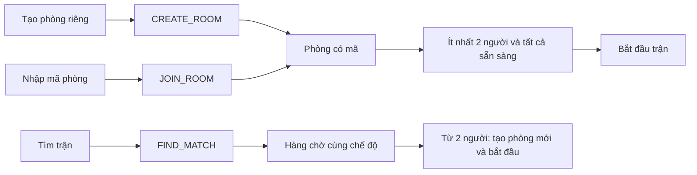

# Rà soát trước bàn giao — Bomb Me Baby

Ngày rà soát ban đầu: 22/10/2026, trên `d8084b5` cùng các file bot trong workspace. **R1–R8 đã được sửa sau đợt rà soát này**; xem [kết quả hoàn thiện và kiểm chứng](FINAL_VALIDATION.md). Các mô tả và số test bên dưới là bằng chứng lịch sử trước khi sửa.

Đã đọc `final-project/Instruction.md`, `Topics.md` (Chủ đề 2), `Submission.md`, mẫu `final-project/README.md`, `TEAM_PLAN.md`, protocol, runbook, playtest và thực nghiệm. Thư mục thực tế tên là `final-project`, không phải `final_project`.

## Kết luận

Project đã có phần cốt lõi phù hợp đề tài game mạng: Java giữ trạng thái chính thức, Unity gửi ý định điều khiển, TCP JSON, xử lý nhiều kết nối, khóa room, heartbeat/reconnect, đồng bộ chọn lọc và số liệu so sánh baseline/optimized. Chưa nên coi là bản sẵn sàng nộp: còn lỗi chuyển trạng thái client, khôi phục phòng và một số sai lệch luật/hiển thị.

Ưu tiên sửa R1–R3 trước khi chạy buổi playtest cuối; sau đó R4–R8. Bản review không xác nhận trải nghiệm hình/âm trên máy người chơi vì chưa chạy lại nhiều Unity client thật trong lượt này.

## Tạo phòng riêng và tìm trận

**Không ghép chung hai luồng.** Người tạo phòng riêng phải gửi mã để người khác vào bằng `JOIN_ROOM`. `FIND_MATCH` chỉ ghép người trong hàng chờ cùng `QUICK` hoặc `JOURNEY`.



- Đã kiểm tra trên cả hai sync mode: một host trong phòng riêng + một người tìm trận → người tìm vẫn chờ, phòng riêng vẫn có một người. Thêm người tìm thứ hai → hai người tìm vào một phòng mới; host không được ghép cùng.
- Tìm trận bắt đầu ngay khi có ít nhất hai người ở một tick; không đợi đủ bốn. Muốn một nhóm bạn chắc chắn cùng phòng thì dùng mã phòng.
- Phòng đang chơi không nhận người mới. Hành trình đã bắt đầu cũng không nhận người mới ở khoảng nghỉ giữa chương.
- Code: `Matchmaker.takeMatches`, `BombServer.matchmake`, các nhánh `CREATE_ROOM`, `JOIN_ROOM`, `FIND_MATCH`.

## Lỗi và thiếu sót đã xác định

P1: có thể làm sai/kẹt luồng chính; P2: ảnh hưởng độ tin cậy, gameplay hoặc thông tin cho người chơi.

### R1 — P1: snapshot cũ ghi đè trạng thái kết thúc trận

- Vị trí: `BombNetwork.cs:211,230`; `BombGame.cs`, các nhánh `STATE_UPDATE`, `GAME_OVER`, `ROOM_STATE`.
- `EnqueueIncoming` tách snapshot sang `latestSnapshot`, nhưng `TryReceive` luôn lấy hết event thường trước. Vì vậy thứ tự TCP không được giữ giữa event và snapshot.
- Ca tái hiện dùng **chính BombNetwork.cs hiện tại**, chỉ thay Unity JsonUtility bằng stub không được gọi trong ca này:

```text
Nhận: STATE_UPDATE(PLAYING, tick=42) -> GAME_OVER -> ROOM_STATE(FINISHED)
Trả cho client: GAME_OVER -> ROOM_STATE -> STATE_UPDATE
CLIENT_FINAL_PHASE=PLAYING; EXPECTED=FINISHED
```

- Hậu quả: client có thể hiện lại HUD trận, mất popup kết quả; server ở FINISHED không gửi snapshot định kỳ nữa nên client không tự phục hồi. Rời phòng/chuyển vòng cũng có nguy cơ áp dụng state cũ.
- Hướng sửa: giữ quan hệ thứ tự giữa snapshot và event khi gộp; không cho snapshot của vòng/phòng cũ vượt qua các mốc `GAME_OVER`, `LEFT_ROOM`, `GAME_START`. Thêm định danh phòng/vòng vào snapshot nếu cần, và kiểm tra trạng thái trước khi áp dụng. Test cần bao phủ event + snapshot tới trong cùng một frame.

### R2 — P1: kết nối lại ở sảnh có thể mắc trong phòng không còn tồn tại

- Vị trí: `BombServer.disconnect:229`, `resume:253`, nhánh `LEAVE_ROOM`; `BombGame` nhánh `WELCOME` và `NETWORK_ERROR`.
- Khi mất mạng trong WAITING, server bỏ player khỏi phòng. Resume trong 10 giây vẫn thành công nhưng nếu không còn phòng thì chỉ gửi `WELCOME`, `ACK`.
- Probe TCP thật nhận đúng `[WELCOME, ACK]`, `player.room == null`. Unity giữ `room` cũ trong `WELCOME`, đồng thời xóa trạng thái reconnect.
- Nút Sẵn sàng sau đó nhận `NOT_IN_ROOM`; nút Rời phòng cũng không cứu được vì server không phát `LEFT_ROOM` khi `room == null`.
- Hướng sửa: thông báo rõ trạng thái không có phòng khi resume; client xóa room/actor/UI cũ theo trạng thái đó. Cho `LEAVE_ROOM` trả kết quả xác nhận cả khi đã ở ngoài phòng. Test cần kiểm tra resume ở menu, lobby, đang chơi, nghỉ chương và hoàn tất hành trình.

### R3 — P2: tạo phòng có thể đua với luồng dọn phòng rỗng

- Vị trí: `BombServer.java:60,78`, nhánh `CREATE_ROOM`.
- `createRoom()` đưa phòng rỗng vào registry trước khi `join()` thêm host. Game loop có thể thấy phòng rỗng và xóa nó trong khoảng này; kiểm tra `isEmpty()` và `rooms.remove()` cũng chưa nguyên tử với join.
- Đã dựng lịch thực thi có kiểm soát: tạo phòng → game loop kiểm tra/xóa phòng rỗng → host join. Kết quả host trỏ tới room nhưng room không còn trong registry.
- Hậu quả: mã phòng có thể không tìm thấy; nếu các player đã giữ tham chiếu room, room không được game loop tick.
- Đây là xác nhận một lịch xen kẽ hợp lệ, chưa đo tần suất xảy ra tự nhiên ngoài thực tế.
- Hướng sửa: chỉ công bố phòng sau khi đã thêm host, và đồng bộ việc kiểm tra/xóa với join; thêm test concurrency bằng latch.

### R4 — P2: bóng lớn lên có thể kẹt bên trong vùng va chạm của đá

- Vị trí: `GameRoom.java:243` (`pickup`), `:408` (`movePlayer`).
- Nhặt orb tăng size mà không giải quyết phần collider mới chồng vào đá. Mỗi bước di chuyển chỉ chấp nhận vị trí cuối hoàn toàn trống.
- Probe trên đá thật của map: bóng size 1 đứng cách mép đá 0,401; đặt tám orb trong tầm nhặt. Size thành 1,96. Gửi MOVE ra xa đá ở 20 tick × 50 ms: vị trí không đổi ở cả baseline và optimized.
- Orb tập trung có thể xuất hiện sau nổ; lỗi phụ thuộc vị trí và số orb. Không khẳng định mọi lần tăng size đều kẹt. Giảm size bằng kỹ năng có thể thoát, nhưng di chuyển thường không tự thoát.
- Hướng sửa: giải quyết chồng lấn khi size/baseSize tăng, hoặc cho phép bước di chuyển làm giảm độ lún vào vật cản. Test ở mép đá, góc nhiều đá và biên map.

### R5 — P2: resume khi trận vừa kết thúc không phục hồi kết quả

- Vị trí: `BombServer.resume:253`, `GameRoom.roomInfo:594`.
- Probe TCP: ngắt A trong trận Hành trình, cho vòng kết thúc trong thời gian giữ chỗ, rồi resume A. Server trả `[WELCOME, ROOM_STATE, PLAYER_RECONNECTED, ACK]`, không có `GAME_OVER`/snapshot kết quả; ROOM_STATE cũng không chứa winnerId.
- Unity biết phase FINISHED nhưng không biết đúng người thắng/lý do kết thúc; có thể hiện sai kết quả hoặc không phát âm kết quả. Trường hợp hoàn tất hành trình còn cần phục hồi `winnerIds` và trạng thái kết thúc.
- Hướng sửa: lưu kết quả cuối vòng trong room và gửi lại khi resume; dữ liệu phục hồi phải đủ để dựng UI, không phụ thuộc một event đã bỏ lỡ.

### R6 — P2: hướng dẫn người thắng bằng điểm không khớp server

- Vị trí: `BombGame.cs:1321`; `GameRoom.java:470`; `docs/GAME_STORY_MODES.md:43`, `docs/STORY_SCRIPT.md:24`.
- UI ghi “người nhiều điểm nhất thắng”. Server xét **số mảnh/vòng thắng → số lần hạ → người thắng chương cuối**.
- Probe gọi logic xét thắng hiện tại: A có 2 mảnh/6 điểm, B có 1 mảnh/7 điểm → server chọn A.
- Chốt một luật thống nhất rồi cập nhật UI, JSON lời dẫn, protocol và tài liệu. Nếu giữ luật code hiện tại thì sửa mô tả “nhiều điểm” thành “nhiều mảnh”, giải thích cách phá hòa.
- Hướng dẫn “đứng 3 giây phá ấn” cũng thiếu điều kiện: khi chủ mảnh cùng đứng trên bệ, `OWNER_DEFENSE_SPEED_FACTOR=0.5` làm thời gian thực tế khoảng 6 giây; khoảng bảo hộ bệ còn có thể trì hoãn thêm.

### R7 — P2: đồng hạng/hòa bị hiển thị như thua

- Vị trí: `BombGame.cs:1253–1259` và nhánh `JOURNEY_COMPLETE`.
- Server có `winnerIds` khi đồng hạng nhưng client chỉ xét `winnerId == myId`; winnerId rỗng làm tiêu đề thành “BẠN ĐÃ THUA” và phát nhạc thua, trong khi dòng trạng thái có thể ghi “đồng hạng”. Tương tự, Đấu nhanh không còn người sống là hòa nhưng popup cũng ghi thua.
- Xác nhận bằng đối chiếu nhánh code; chưa chạy cảnh hòa bằng Unity trong lượt review này.
- Hướng sửa: phân biệt thắng/thua/hòa, dùng danh sách winnerIds ở Hành trình; không phát nhạc thua cho người đồng thắng.

### R8 — P2: Boost ở size tối thiểu vẫn tạo orb miễn phí

- Vị trí: `GameRoom.action`, nhánh `USE_BOOST`, và `pickup`.
- Size bị chặn không xuống dưới baseSize nhưng vẫn sinh orb. Đứng yên khiến orb sinh đúng tại chân rồi bị nhặt lại.
- Probe: size 1, HP 70 → dùng Boost, một tick → size 1,12 và HP 73. Cả hai sync mode giống nhau.
- Đây là khe hở kinh tế vật phẩm/cân bằng: có thể tự tạo orb để hồi máu khi không trả đủ size. Không phải tăng size vô hạn mỗi lần; sau những lần tiếp theo ở điều kiện này size có thể ổn định tại 1,12.
- Hướng sửa: lượng orb phải dựa trên size thực đã tiêu hao, hoặc định nghĩa rõ Boost miễn phí không sinh orb. Cần chốt hành vi mong muốn trước khi sửa cân bằng.

## Gia cố kỹ thuật và trải nghiệm tiếp theo

- `BombServer.Connection.run` kiểm tra 2048 ký tự **sau** `BufferedReader.readLine()`. Dòng cực dài/chưa có newline vẫn có thể được tích lũy trước khi kiểm tra. Nên giới hạn số byte/ký tự ngay khi đọc và có giới hạn request/giây nếu cho server ra Internet. Chưa chạy thử gây tải lớn trong đợt này.
- Inbox Unity bỏ event cũ khi vượt 256. Nên có cơ chế phục hồi trạng thái đầy đủ hoặc reconnect có kiểm soát thay vì âm thầm bỏ event quan trọng. Cần stress test khi Unity bị giật/khựng.
- Nút “Tạo phòng riêng” nằm nhỏ trong góc khung Tìm trận; nên đặt rõ hơn và ghi “Bạn bè vào bằng mã”. Đây là vấn đề dễ hiểu luồng, không phải lỗi server.
- Đấu nhanh chưa có giới hạn thời gian/thu hẹp vòng. Hai người chỉ trốn nhau có thể kéo dài trận vô hạn. Đây là quyết định gameplay cần cân nhắc cho demo, không phải yêu cầu bắt buộc của thầy.
- Cần đo FPS/GC và tài nguyên Unity qua nhiều vòng, không chỉ compile. Chưa có bằng chứng profiler để kết luận đã tối ưu bộ nhớ/đồ họa.

## Đối chiếu yêu cầu của thầy

| Yêu cầu | Hiện trạng | Việc còn làm |
| --- | --- | --- |
| Topic hợp lệ | Phù hợp Chủ đề 2 — Multiplayer Battle Game | Ghi rõ topic và phạm vi trong báo cáo |
| Client/server, network/protocol | Có TCP JSON, server kiểm tra hành động và giữ state | Sửa các lỗi vòng đời nêu trên; cập nhật sequence diagram |
| Concurrency/error handling | Có room lock, reader pool, writer queue, timeout, resume, sequence | Bổ sung test chuyển trạng thái, publication race, giới hạn input |
| Novelty có bằng chứng | Có selective sync, baseline/optimized | Giải thích implementation và đo lại trên phiên bản cuối; hình/âm không thay thế novelty |
| Thực nghiệm | Có 18 lượt đo ngày 19/10, 0 lỗi theo CSV; đủ 18 file raw | Đo lại cùng commit/map/kịch bản; thêm Hành trình/reconnect và LAN nếu có điều kiện |
| Kiểm thử nhiều client thật | Có ghi nhận lịch sử; checklist hiện tại còn trống | Chạy 2–4 Unity client trên build cuối, đủ ba map, ghi vào PLAYTEST_MAPS |
| README chạy được | Có hướng dẫn server/client/protocol | Bỏ các câu cũ “chưa có bot/matchmaking”; cập nhật hướng dẫn và kiểm trên máy sạch |
| Report theo technical paper | Repository có hai báo cáo tiến độ và GDD | Chưa thấy báo cáo cuối đúng tên, kết quả Compilatio; không thể xác nhận tài liệu ngoài repository |
| Source/Report để nộp | Chưa thấy bộ bàn giao cuối trong repository | Đóng gói source, config, asset, hướng dẫn và báo cáo đúng phiên bản |

Database, đăng nhập, TLS, Docker/VPS **không phải tất cả đều bắt buộc** cho topic này. Đề yêu cầu thể hiện giao tiếp mạng, concurrency, error handling, novelty và đo lường. Không cần mở thêm tính năng không phục vụ các mục tiêu đó chỉ để tăng số lượng chức năng.

`final-project/README.md` là mẫu của thầy; các chỗ `...` trong đó không phải lỗi của game. README ở gốc mới là tài liệu chạy dự án cần hoàn thiện.

Theo `Submission.md`, báo cáo tên `NhomXX_TenProject_Report.docx`, bộ bàn giao có `Source/` và `Report/`, hạn **23:59 ngày 31/10/2026**. `Instruction.md` yêu cầu **Similarity + Plagiarism ≤ 20%**. Hướng dẫn chung đề cập Drive; hướng dẫn nộp cụ thể còn yêu cầu lớp trưởng tập hợp USB. Chuẩn bị theo tài liệu nộp cụ thể và thông báo cuối của lớp.

## Kết quả kiểm tra trong lượt này

- `mvn -q test -Dsync.mode=baseline`: 83 test, 0 failure/error.
- `mvn -q test -Dsync.mode=optimized`: 83 test, 0 failure/error.
- Trong 83 test có 6 test bot từ file chưa được Git theo dõi; bản clone chỉ từ commit hiện tại chưa có những file đó.
- `dotnet build Assembly-CSharp.csproj --no-restore`: 0 lỗi, 1 cảnh báo MSB3277 về System.Net.Http từ các package Unity AI. Đây là kiểm tra compile C#, không phải build player hay playtest hình/âm.
- Java probe riêng xác nhận ghép phòng, kẹt do tăng size, Boost, resume lobby/kết quả trên cả hai sync mode; cùng probe kiểm tra lịch xen kẽ cleanup và cách xét thắng Hành trình.
- C# probe chạy trực tiếp mã hàng đợi BombNetwork xác nhận R1.
- Các probe ban đầu đã được thay bằng regression test: `CompletionRegressionTest.java`, `ConnectionTest.java` và `scripts/validation/NetworkRegression.cs`, khẳng định hành vi đúng sau khi sửa.
- Không thay đổi file gameplay/network trong lượt review. Không chạy benchmark mới, không ghi số liệu playtest giả, không xác nhận đã test LAN/Internet hoặc Compilatio.

## Thứ tự hoàn thiện đề xuất

1. Sửa R1, R2, R3; bổ sung regression test cho thứ tự message và vòng đời phòng.
2. Sửa kẹt tăng size và phục hồi kết quả; thống nhất luật thắng, hòa và Boost.
3. Build Windows cuối; chạy 2–4 Unity client: phòng riêng, tìm trận, chơi lại, ba chương, mất mạng ở từng phase, rời trận, thu nhỏ cửa sổ, nhiều vụ nổ/nhặt đồ đồng thời.
4. Điền playtest, đo lại baseline/optimized cùng cấu hình, cập nhật README/runbook/protocol. Kết quả 19/10 chỉ được trình bày là mốc đo cũ.
5. Hoàn thiện báo cáo, trích nguồn, Compilatio, Source/Report. Đưa các file bot hiện chưa được Git theo dõi vào bản source bàn giao nếu vẫn sử dụng.
