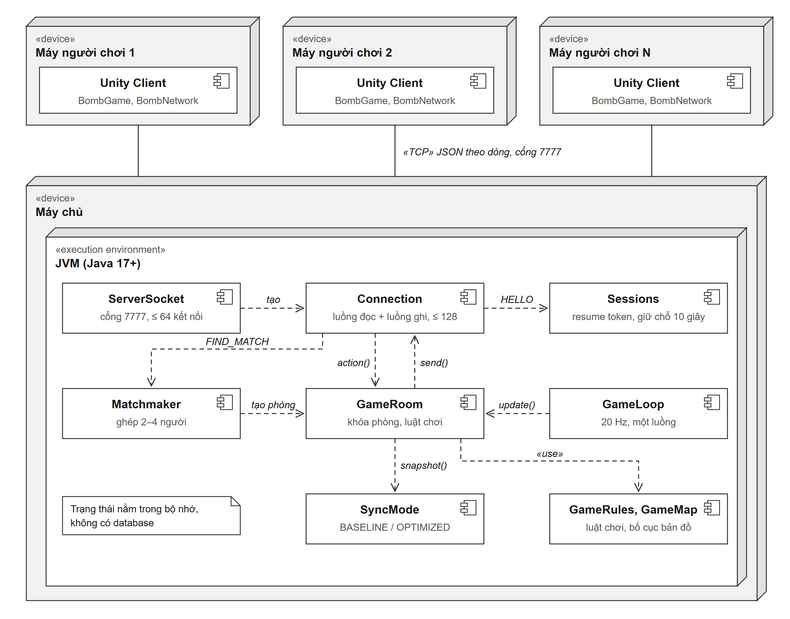
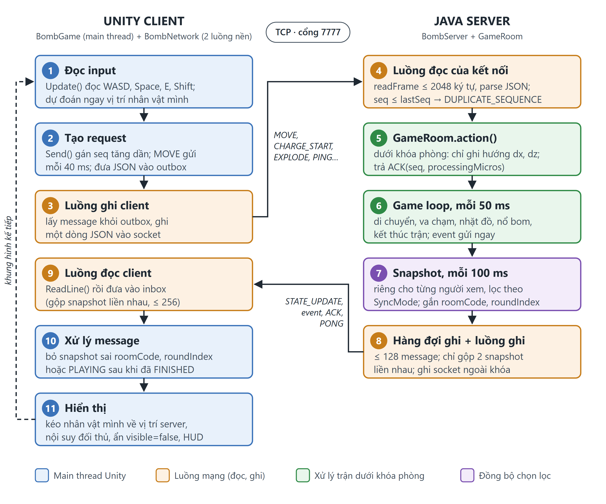
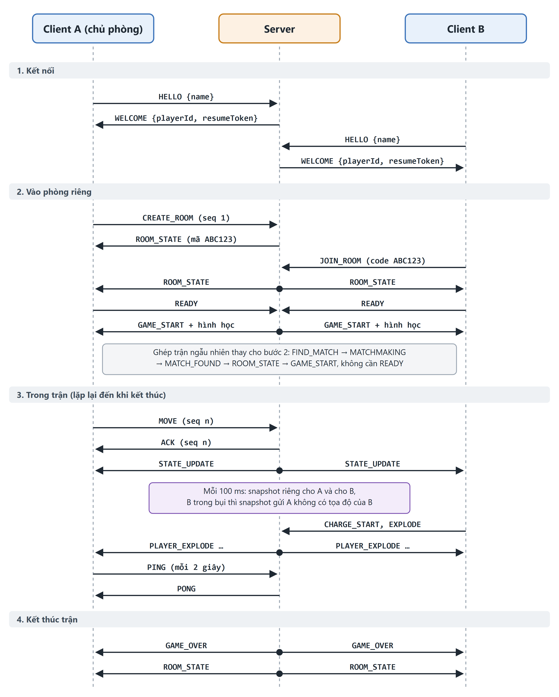
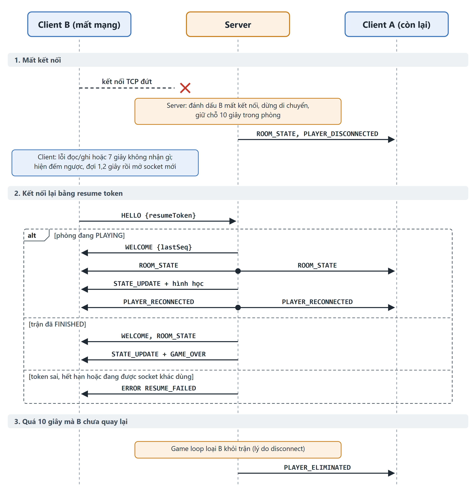

# Bomb Me Baby: game đấu trường nhiều người qua TCP với server quyết định luật và đồng bộ trạng thái chọn lọc

**Báo cáo bài tập lớn môn Lập trình mạng, năm học 2026–2027**

| | |
| --- | --- |
| Nhóm | 07 |
| Chủ đề | Chủ đề 2 – Phát triển game mạng (`final-project/Topics.md`) |
| Giảng viên | Thầy Ngô Văn Quyền |
| Thành viên | Phạm Văn Vỹ (trưởng nhóm), Giang Thủy Tiên, Trần Đỗ Lan Phương. MSSV và phần việc xem [mục 19](#19-thành-viên-và-phân-công) |
| Mã nguồn | https://github.com/VyOZzz/-LTM-Bomb-Me-Baby |
| Ngày cập nhật | 26/10/2026 |

---

## 1. Abstract

Trong game hành động nhiều người, mọi máy phải thấy cùng một trận đấu dù độ trễ mỗi máy khác nhau và kết nối có thể đứt bất kỳ lúc nào. Nếu client tự tính vị trí, máu và sát thương thì trạng thái giữa các máy dễ lệch nhau và người chơi dễ gian lận. Nếu server gửi toàn bộ trạng thái cho mọi người ở mỗi lần cập nhật thì lượng dữ liệu tăng theo số người chơi, đồng thời client biết cả vị trí của đối thủ đang ẩn nấp.

Nhóm xây dựng **Bomb Me Baby**, một game đấu trường PvP 2.5D gồm Java server và Unity client giao tiếp qua TCP. Server giữ quyền quyết định toàn bộ luật chơi (server-authoritative). Client chỉ gửi ý định điều khiển và hiển thị trạng thái nhận về. Giao thức là JSON theo dòng, có số thứ tự `seq` để chống request trùng, heartbeat, timeout và cơ chế reconnect bằng resume token. Server mô phỏng ở 20 Hz và gửi snapshot ở 10 Hz. Đóng góp chính là cơ chế **đồng bộ trạng thái chọn lọc**: hình học bản đồ chỉ gửi một lần, vật phẩm và đối thủ chỉ được gửi khi người xem được phép thấy.

Trên loopback với 2, 4 và 8 client giả lập (18 lượt × 30 giây, không có lỗi kết nối), chế độ chọn lọc giảm **62,0–77,8%** số byte mỗi client nhận trong một giây so với baseline gửi đầy đủ. Bộ 115 test JUnit bao phủ kết nối, reconnect, ghép trận và luật chơi ở cả hai chế độ đồng bộ.

## 2. Keywords

Multiplayer game; authoritative server; TCP socket; JSON protocol; selective state synchronization; reconnect.

---

## 3. Introduction

### 3.1. Bối cảnh

Game nhiều người theo thời gian thực là một bài toán điển hình của lập trình mạng. Bài toán gồm nhiều kết nối đồng thời, trạng thái dùng chung giữa các luồng, yêu cầu độ trễ thấp và phải chịu được mất kết nối. Đề tài thuộc Chủ đề 2 trong `final-project/Topics.md`. Trọng tâm của chủ đề là kiến trúc mạng, giao tiếp client/server, đồng bộ trạng thái và xử lý nhiều người chơi.

### 3.2. Vấn đề và động lực

Có ba vấn đề cụ thể:

1. **Nhất quán và chống gian lận.** Nếu client tự quyết định HP hoặc người thắng, mỗi máy có thể cho một kết quả khác nhau.
2. **Băng thông.** Bản đồ có nhiều đá và bụi không thay đổi trong suốt trận. Gửi lại chúng trong mọi snapshot là lãng phí.
3. **Lộ thông tin.** Game có bụi để ẩn nấp. Nếu snapshot vẫn chứa tọa độ người trong bụi thì client sửa đổi có thể nhìn xuyên bụi (map hack).

### 3.3. Problem statement

Thiết kế và triển khai một hệ thống client/server cho game đấu trường 2–10 người, trong đó server giữ trạng thái chính thức, xử lý đồng thời nhiều phòng và nhiều kết nối, chịu được request trùng, client im lặng và mất kết nối tạm thời. Hệ thống cũng phải giảm được lượng dữ liệu đồng bộ so với cách gửi toàn bộ trạng thái, có số đo kiểm chứng.

### 3.4. Mục tiêu

1. Xây dựng server TCP giữ trạng thái chính thức của trận, phục vụ nhiều phòng và nhiều client đồng thời.
2. Thiết kế protocol JSON rõ ràng, có `seq` chống request trùng, heartbeat, timeout và reconnect.
3. Đề xuất cơ chế đồng bộ chọn lọc và đo mức giảm băng thông so với baseline gửi toàn bộ.

### 3.5. Phạm vi

- **Có:** hai chế độ chơi (Đấu nhanh, Hành trình Tim Lửa), ba bản đồ, phòng riêng bằng mã 6 ký tự, ghép trận ngẫu nhiên, tối đa 10 người mỗi phòng, reconnect trong 10 giây, Unity client cho Windows.
- **Chưa có:** tài khoản, mã hóa TLS, lưu lịch sử trận vào database, chống gian lận toàn diện.

### 3.6. Đóng góp chính

1. Đồng bộ trạng thái chọn lọc theo từng người xem, có baseline để so sánh trên cùng luật chơi.
2. Cơ chế phục hồi phiên chơi giữ đúng thứ tự vòng đời trận (resume token, `seq`, định danh phòng và vòng, phát lại kết quả).
3. Mô hình concurrency có thứ tự khóa cố định và hàng đợi ghi riêng cho từng client, để một client chậm không làm chậm cả phòng.

---

## 4. Background / Related Work

**TCP.** TCP cung cấp luồng byte tin cậy và đúng thứ tự [1], nhưng không có khái niệm message. Tầng ứng dụng phải tự xác định ranh giới message. Dự án dùng một JSON object trên mỗi dòng và giới hạn độ dài dòng trong lúc đọc, để không cấp phát vô hạn khi client gửi dòng rất dài. TCP giữ thứ tự byte trên đường truyền. Tuy vậy, nếu ứng dụng tách event và snapshot ra hai hàng đợi rồi xử lý lệch nhau thì thứ tự vẫn có thể sai ở tầng ứng dụng. Dự án đã gặp lỗi này và phải sửa.

**Java socket và thread.** `ServerSocket` và `Socket` trong `java.net` [2] cung cấp blocking I/O. Dự án dùng mô hình một luồng đọc lấy từ thread pool và một luồng ghi riêng cho mỗi kết nối. Mô hình này dễ quan sát và kiểm thử ở quy mô đồ án. Với hàng nghìn kết nối, Java NIO hoặc event loop sẽ hiệu quả hơn, nhưng nhóm chưa đánh giá hướng đó.

**Snapshot và nội suy.** Fiedler [4] mô tả cách client dựng lại hình ảnh từ các snapshot rời rạc và đánh đổi giữa băng thông và độ mượt. Unity client của dự án nội suy vị trí đối thủ giữa hai snapshot, dự đoán ngắn hạn cho nhân vật của chính mình rồi kéo dần về trạng thái server. Đây chưa phải lag compensation hoàn chỉnh vì server không tua lại lịch sử va chạm.

**Interest management.** Nhiều game chỉ gửi cho mỗi người các thực thể nằm trong vùng quan tâm của họ. Hạn chế của cách gửi đầy đủ là kích thước snapshot tăng theo tổng số thực thể và client biết cả những gì nhân vật không nhìn thấy. Dự án áp dụng ý tưởng này ở mức đơn giản: lọc theo khoảng cách nhìn và bụi. Nhóm không tuyên bố phát minh ra interest management.

**Serialization.** Server dùng Gson [5], client dùng Newtonsoft.Json trong Unity [3]. JSON dễ đọc và dễ debug nhưng tốn byte hơn binary. Đây là đánh đổi có chủ đích cho phạm vi đồ án.

---

## 5. Problem Definition

### 5.1. Input

Các request client gửi lên: `HELLO`, `CREATE_ROOM`, `JOIN_ROOM`, `FIND_MATCH`, `CANCEL_MATCH`, `READY`, `MOVE` (hướng di chuyển), `CHARGE_START`, `EXPLODE`, `USE_SHIELD`, `USE_BOOST`, `DROP_SHARD`, `INTERACT_START`, `INTERACT_STOP`, `LEAVE_ROOM`, `PING`. Client **không** gửi HP hay tọa độ tuyệt đối để server tin trực tiếp.

### 5.2. Output

Server gửi về: `WELCOME`, `ROOM_STATE`, `MATCHMAKING`, `MATCH_FOUND`, `GAME_START`, `STATE_UPDATE` (snapshot), các event gameplay (nổ bom, nhặt đồ, loại người chơi), `GAME_OVER`, `JOURNEY_COMPLETE`, `ACK`, `PONG`, `ERROR`.

### 5.3. Ràng buộc

| Ràng buộc | Giá trị |
| --- | --- |
| Số người mỗi phòng riêng | 2–10 |
| Số người mỗi nhóm ghép trận | 2–4 |
| Số kết nối đồng thời | Tối đa 64 |
| Độ dài một frame | Tối đa 2048 ký tự |
| Cửa sổ reconnect | 10 giây |
| Timeout client im lặng | Server đóng sau 6 giây; client tự đóng sau 7 giây |
| Hàng đợi ghi | Tối đa 128 message mỗi kết nối phía server |
| Tick mô phỏng / snapshot | 20 Hz / 10 Hz |

### 5.4. Giả định

- Mạng demo là loopback hoặc LAN tin cậy. Protocol chưa mã hóa.
- Trạng thái phòng và phiên chơi nằm trong bộ nhớ. Khởi động lại server thì mất phiên.
- Baseline và optimized dùng cùng luật chơi để phép so sánh có ý nghĩa.

### 5.5. Điều kiện đúng

- Một người không thể thuộc hai phòng cùng lúc.
- Một vật phẩm không bị trao cho hai người.
- Snapshot cũ không được mở lại một trận đã kết thúc.
- Người reconnect nhận đủ hình học bản đồ và kết quả trận.
- Ở chế độ optimized, người bị che không bị lộ tọa độ qua snapshot hoặc event.

---

## 6. Proposed Approach

### 6.1. Ý tưởng

Server là nguồn trạng thái duy nhất. Mỗi tick 50 ms, server xử lý timeout, di chuyển và va chạm, nhặt vật phẩm, nổ bom, mục tiêu Hành trình và điều kiện kết thúc. Sau mỗi hai tick, server tạo snapshot **riêng cho từng người xem**.

### 6.2. Thuật toán đồng bộ chọn lọc

Với mỗi người xem `v` trong phòng, ở mỗi chu kỳ snapshot:

1. **Hình học tĩnh.** Ở chế độ optimized, đá và bụi chỉ có trong `GAME_START` và trong snapshot khôi phục sau reconnect. Ở baseline, chúng được gửi lại trong mọi snapshot.
2. **Người chơi.** Với mỗi người chơi `p ≠ v`, server xét xem `v` có được thấy `p` không, dựa trên khoảng cách (bán kính nhìn 26 đơn vị), bụi (người trong bụi chỉ hiện với người cũng ở gần trong bụi đó) và thông tin công khai của mục tiêu Hành trình. Nếu không thấy, tọa độ của `p` được thay bằng 0 và cờ `visible=false`.
3. **Vật phẩm.** Energy và Core chỉ được gửi khi nằm trong tầm nhìn của `v`.
4. **Sự kiện nổ.** Nếu `v` không thấy nguồn nổ thì event gửi cho `v` không có tọa độ.
5. **60 giây cuối Đấu nhanh.** Vị trí mọi người được công khai trên minimap theo luật chơi, nên server gửi tọa độ cho tất cả.

Đây là chọn lọc nội dung snapshot, không phải nén delta từng trường giữa hai snapshot.

### 6.3. Thứ tự message và phục hồi

- Hàng đợi ghi chỉ gộp hai snapshot khi chúng đứng liền nhau. Một event đứng giữa đóng vai trò mốc thứ tự, nên snapshot không thể vượt lên trước event.
- Snapshot khôi phục (có hình học) không bị thay thế bởi snapshot thường không có hình học.
- Mỗi snapshot mang `roomCode` và `roundIndex`. Client bỏ qua snapshot của phòng hoặc vòng khác, và không chấp nhận trạng thái `PLAYING` khi vòng đã `FINISHED`.
- Khi hàng đợi đầy, server đóng kết nối để client reconnect và nhận lại trạng thái đầy đủ, thay vì âm thầm bỏ event.

### 6.4. Các quyết định thiết kế

| Quyết định | Lý do |
| --- | --- |
| TCP thay vì UDP | Event vòng đời trận (bắt đầu, loại, kết thúc) không được mất. Ở quy mô LAN, độ trễ do TCP gây ra chấp nhận được. |
| JSON theo dòng | Dễ debug bằng log, dễ viết bot bằng Python, không phụ thuộc thư viện protocol riêng. |
| Server-authoritative | Một nguồn sự thật duy nhất, chống chỉnh HP hoặc tọa độ từ client. |
| Khóa theo phòng | Mọi thay đổi của một phòng được tuần tự hóa, các phòng khác nhau chạy độc lập. |
| Không dùng database | Phạm vi là phiên chơi. Không có tài khoản hay lịch sử nên chưa cần lưu trữ bền vững. |

---

## 7. System Architecture

### 7.1. Sơ đồ



*Hình 1. Kiến trúc hệ thống.* Mỗi Unity client giữ một kết nối TCP với server. Trên server, luồng đọc của từng kết nối chuyển request vào `GameRoom` dưới khóa phòng; game loop 20 Hz cập nhật trạng thái, tạo snapshot riêng cho từng người xem theo `SyncMode` rồi đưa vào hàng đợi ghi của từng `Connection`.

### 7.2. Thành phần

| Thành phần | Vị trí | Nhiệm vụ |
| --- | --- | --- |
| Client (Unity) | `LTM-Bomb-Me-Baby/Assets/Scripts/` | Đọc input, gửi ý định điều khiển, nhận snapshot, nội suy và hiển thị, HUD, âm thanh |
| Network layer phía client | `BombNetwork.cs` | Socket TCP, luồng ghi nền, inbox giới hạn, heartbeat, tự reconnect |
| Network layer phía server | `BombServer.java` | Lắng nghe cổng, đọc frame, kiểm tra `seq`, điều phối request, quản lý phiên |
| Processing | `GameRoom.java`, `ShardObjective.java`, `GameRules.java` | Mô phỏng trận, luật chiến đấu, mục tiêu Hành trình |
| Service | `Matchmaker.java` | Hàng đợi tìm trận theo chế độ, ghép 2–4 người |
| Đồng bộ | `SyncMode.java` | Chọn `BASELINE` hoặc `OPTIMIZED` |
| Database | Không có | Trạng thái nằm trong bộ nhớ (xem mục 6.4) |

### 7.3. Luồng xử lý từ client tới server



*Hình 2. Luồng một lần cập nhật.* Bước 1–3 chạy ở client, bước 4–8 ở server, bước 9–11 quay lại client. Màu của mỗi ô cho biết bước đó chạy trên luồng nào.

**Chiều lên, từ client tới server.** Ở mỗi khung hình, `BombGame.Update()` trên main thread của Unity đọc phím và dự đoán ngay vị trí nhân vật của chính mình, để người chơi không phải chờ server mới thấy nhân vật chạy (bước 1). Hướng di chuyển được gửi bằng `MOVE` mỗi 40 ms. `Send()` gán `seq` tăng dần rồi đưa JSON vào outbox (bước 2). Luồng ghi nền của `BombNetwork` lấy message khỏi outbox và ghi thành một dòng vào socket, nên main thread không bị chặn bởi I/O mạng (bước 3).

**Xử lý ở server.** Luồng đọc của kết nối đọc từng dòng, đóng kết nối khi dòng dài quá 2048 ký tự và trả `DUPLICATE_SEQUENCE` khi `seq` không tăng (bước 4). Request hợp lệ được chuyển vào `GameRoom.action()` dưới khóa phòng. Với `MOVE`, server chỉ ghi lại hướng chứ không dịch chuyển nhân vật ngay, rồi trả `ACK` (bước 5). Việc dịch chuyển thật do game loop thực hiện mỗi 50 ms, cùng với va chạm, nhặt vật phẩm, nổ bom và kiểm tra kết thúc trận. Event như nổ bom hay loại người chơi được đưa vào hàng đợi ghi ngay khi xảy ra (bước 6). Cứ hai tick, server tạo snapshot riêng cho từng người xem theo `SyncMode` (bước 7, chi tiết ở mục 6.2). Luồng ghi riêng của từng kết nối lấy message khỏi hàng đợi và ghi ra socket ngoài khóa phòng (bước 8).

**Chiều xuống, từ server về client.** Luồng đọc nền của client đọc từng dòng và đưa vào inbox. Nếu hai snapshot đứng liền nhau thì chỉ giữ snapshot mới hơn, trừ khi snapshot cũ mang hình học mà snapshot mới không có (bước 9). Đầu mỗi khung hình, main thread lấy hết message khỏi inbox. Snapshot của phòng hoặc vòng khác, hoặc snapshot `PLAYING` đến sau khi trận đã `FINISHED`, bị bỏ qua (bước 10). Snapshot hợp lệ được áp dụng: nhân vật của mình được kéo dần về vị trí server, hoặc đặt thẳng về đó nếu lệch quá 2 đơn vị; đối thủ được nội suy giữa hai snapshot; người có `visible=false` bị ẩn; HUD cập nhật HP, Size và hồi chiêu (bước 11). `BombNetwork` không gọi API dựng hình trên luồng mạng, mọi thay đổi cảnh đều diễn ra trên main thread.

### 7.4. Xử lý khi có cập nhật trạng thái trong trận

Trạng thái trận chỉ do server giữ và thay đổi. Mỗi thay đổi được gửi xuống client bằng một trong bốn loại message. Mỗi loại được server gửi và client xử lý theo cách riêng:

| Loại cập nhật | Message | Server | Client |
| --- | --- | --- | --- |
| Trạng thái liên tục: vị trí, HP, Size, hồi chiêu, vật phẩm, đồng hồ | `STATE_UPDATE` | Tạo snapshot đầy đủ cho từng người xem mỗi 100 ms, kể cả khi không có gì thay đổi. Nếu snapshot trước chưa kịp gửi thì thay bằng snapshot mới | Thay trạng thái hiển thị bằng snapshot mới, nội suy đối thủ, kéo nhân vật của mình về vị trí server. Bỏ snapshot sai phòng hoặc sai vòng |
| Sự kiện tức thời | `PLAYER_EXPLODE`, `PLAYER_DAMAGED`, `ENERGY_PICKED`, `SHIELD_ACTIVATED`, `PLAYER_ELIMINATED`… | Gửi ngay khi xảy ra, không chờ chu kỳ snapshot, không gộp và không bỏ. Bỏ tọa độ nếu người xem không thấy nguồn sự kiện | Chạy hiệu ứng, âm thanh và thông báo, không tự sửa HP hay vị trí. Riêng `PLAYER_ELIMINATED` ẩn nhân vật ngay, vì trận có thể kết thúc trước snapshot kế tiếp |
| Vòng đời phòng và trận | `ROOM_STATE`, `GAME_START`, `GAME_OVER`, `JOURNEY_COMPLETE`, `PLAYER_DISCONNECTED`, `PLAYER_RECONNECTED` | Gửi dưới khóa phòng ngay khi phòng đổi trạng thái | Đổi `phase` và màn hình. Sau `GAME_OVER`, snapshot `PLAYING` đến muộn bị bỏ |
| Phản hồi request | `ACK`, `ERROR`, `PONG` | Chỉ gửi cho người đã gửi request | `ACK` và `PONG` dùng để đo thời gian xử lý và RTT. `ERROR` hiện thông báo; trạng thái đúng sẽ có trong snapshot tiếp theo |

Nguyên tắc chung là server luôn đúng. Client chỉ đoán trước vị trí nhân vật của chính mình, còn HP, Size, sát thương và người thắng đều chờ server. Khi phần đoán lệch với snapshot, client sửa theo snapshot.

**Ví dụ: người chơi B nổ bom trúng người chơi A.**

1. B nhấn giữ Space, client B gửi `CHARGE_START`. Server ghi thời điểm bắt đầu tụ lực, hoặc trả `ERROR BOMB_COOLDOWN` nếu bom đang hồi chiêu.
2. B thả Space, client B gửi `EXPLODE`. Luồng đọc của B gọi `GameRoom.action()` dưới khóa phòng và xử lý ngay, không chờ tick: tính bán kính nổ theo Size và lực tụ, trừ HP từng người trong vùng nổ (người đang bật khiên phản lại một nửa sát thương), đặt hồi chiêu và đưa Size của B về mức gốc.
3. Ngay trong lần xử lý đó, server đưa vào hàng đợi ghi của từng người lần lượt `PLAYER_DAMAGED` cho A, `PLAYER_ELIMINATED` nếu HP của A về 0, rồi `PLAYER_EXPLODE`. `PLAYER_EXPLODE` có tọa độ với người thấy B và không có tọa độ với người không thấy B.
4. Client A, B và những người khác nhận event, chạy hiệu ứng nổ, âm thanh và thông báo. Thanh máu chưa đổi.
5. Trong vòng 100 ms, snapshot kế tiếp mang HP mới của A và Size mới của B, client cập nhật HUD. Vì event đứng trước snapshot trong hàng đợi và hàng đợi không cho snapshot vượt event (mục 6.3), hiệu ứng không bao giờ xuất hiện sau khi con số đã đổi.

---

## 8. Network Communication Design

### 8.1. Protocol và kết nối

- **Giao thức:** TCP, kết nối giữ suốt phiên chơi, mặc định cổng 7777.
- **Message format:** mỗi message là một JSON object trên một dòng UTF-8, kết thúc bằng LF hoặc CRLF, tối đa 2048 ký tự.
- **Thiết lập:** client mở socket rồi gửi `HELLO`. Server trả `WELCOME` kèm `playerId` và `resumeToken`.
- **Đóng kết nối:** client gửi `LEAVE_ROOM` rồi đóng socket, hoặc server đóng khi timeout, frame quá lớn hay hàng đợi đầy.

### 8.2. Message format

```json
{"type":"HELLO","name":"Bom A","resumeToken":""}
{"type":"WELCOME","playerId":"...","resumeToken":"...","syncMode":"OPTIMIZED","demoMap":""}
{"type":"CREATE_ROOM","seq":1,"mode":"QUICK"}
{"type":"JOIN_ROOM","seq":2,"code":"ABC123"}
{"type":"FIND_MATCH","seq":3,"mode":"JOURNEY"}
{"type":"MOVE","seq":4,"directionX":0.8,"directionZ":0.3}
{"type":"ACK","seq":4,"processingMicros":31}
{"type":"PING","clientTime":1720000000000}
{"type":"ERROR","code":"DUPLICATE_SEQUENCE"}
```

Trừ `HELLO` và `PING`, mọi request phải có `seq` lớn hơn mọi `seq` server đã nhận trong cùng phiên. `seq` không reset khi đổi phòng hay reconnect. `ACK` chỉ xác nhận server đã xử lý message, không khẳng định hành động gameplay thành công. Client vẫn phải đọc `ERROR` nếu có. Đặc tả đầy đủ ở `docs/PROTOCOL.md`.

### 8.3. Communication sequence



*Hình 3. Trình tự message của một trận phòng riêng.* Chấm tròn trên đường của server nghĩa là message được gửi cho cả hai client. Riêng `STATE_UPDATE` có nội dung khác nhau cho từng người xem.

Trong trận, client gửi `MOVE` mỗi 40 ms và `PING` mỗi 2 giây. Server trả `ACK` cho mọi request có `seq` và gửi snapshot mỗi 100 ms, độc lập với nhịp gửi của client. Với ghép trận, client gửi `FIND_MATCH`. Khi đủ ít nhất hai người cùng chế độ, server ghép ở tick kế tiếp, gửi `MATCH_FOUND`, `ROOM_STATE` rồi `GAME_START` mà không cần `READY`.

### 8.4. Reconnect

Khi TCP đứt, server giữ chỗ người chơi 10 giây. Client mở socket mới và gửi `HELLO` kèm `resumeToken`. Nếu phòng đang `PLAYING`, server trả `WELCOME` (có `lastSeq`), `ROOM_STATE` và một snapshot đầy đủ có hình học. Nếu trận đã `FINISHED`, server phát lại `GAME_OVER` (và `JOURNEY_COMPLETE` nếu có). Token lạ, hết hạn hoặc đang được socket khác dùng thì nhận `RESUME_FAILED`.



*Hình 4. Trình tự mất kết nối và kết nối lại.* Client phát hiện mất kết nối khi đọc hoặc ghi socket bị lỗi, hoặc khi 7 giây không nhận được message nào. Client hiện đếm ngược 10 giây rồi tự mở socket mới sau 1,2 giây. Quá 10 giây mà chưa quay lại thì game loop loại người chơi khỏi trận.

### 8.5. Error handling

| Tình huống | Cách xử lý |
| --- | --- |
| JSON sai, thiếu trường | Trả `ERROR INVALID_MESSAGE`, giữ kết nối |
| Request trùng hoặc cũ | `seq` không tăng → `DUPLICATE_SEQUENCE`, không thực hiện lại |
| Sai trạng thái | `NOT_IN_ROOM`, `ACTION_UNAVAILABLE`, `ROOM_UNAVAILABLE`, `BOMB_COOLDOWN`, `ALREADY_SEARCHING`, `INVALID_MODE` |
| Frame quá lớn | Đóng socket khi vượt 2048 ký tự, kể cả khi chưa gặp newline |
| Client im lặng | Server đóng sau 6 giây không nhận message hợp lệ |
| Server im lặng | Client tự đóng sau 7 giây rồi thử reconnect |
| Ghi bị treo | Đóng kết nối nếu một lần ghi kéo dài quá 3 giây hoặc hàng đợi đầy 128 |
| Mất kết nối | Giữ chỗ 10 giây, quá hạn thì loại người chơi |
| Quá tải | Từ chối kết nối thứ 65 trở đi |
| Input cũ | Hướng di chuyển tự về 0 sau 0,5 giây nếu không có `MOVE` mới |

---

## 9. Implementation

### 9.1. Module

| Module | Số dòng | Nội dung chính |
| --- | ---: | --- |
| `BombServer.java` | 448 | Accept loop, đọc frame, kiểm tra `seq`, phiên và resume token, game loop, watchdog |
| `GameRoom.java` | 938 | Trạng thái phòng, va chạm, nổ bom, nhặt đồ, xếp hạng, tạo snapshot theo người xem |
| `ShardObjective.java` | 306 | Mảnh Tim Lửa, bệ đá, phá ấn, cướp mảnh, thời gian chương |
| `Matchmaker.java` | 93 | Hàng đợi theo chế độ, ticket có generation |
| `GameRules.java`, `GameMap.java` | 178 | Hằng số luật chơi, bố cục ba bản đồ |
| `SyncMode.java` | 46 | Chuyển giữa baseline và optimized |
| `BombNetwork.cs` | 276 | Socket client, luồng ghi nền, inbox, heartbeat, reconnect |
| `BombProtocol.cs` | 226 | DTO cho các message |
| `BombGame.cs` | 2058 | Xử lý message, nội suy, điều khiển cảnh và camera |
| HUD, menu, bản đồ, VFX, âm thanh | khoảng 3 000 | `BombHud`, `BombModeMenu`, `BombMapView`, `BombVfx`, `BombAudio`… |

Server có tổng cộng 2 055 dòng Java. Client có khoảng 6 500 dòng C# trong `Assets/Scripts`.

### 9.2. Cấu trúc dữ liệu

- `PlayerState`: vị trí, hướng, HP, Size, cooldown, `lastSeq`, cờ kết nối, thời điểm mất kết nối, hàng đợi ghi.
- `GameRoom`: danh sách người chơi, danh sách Energy và Core, hình học bản đồ, `phase` (`WAITING`, `PLAYING`, `FINISHED`), `roundIndex`, bảng xếp hạng.
- Registry ở server: map mã phòng → `GameRoom`, map token → phiên, có thời điểm hết hạn.

### 9.3. Concurrency

- **Luồng:** mỗi client có một luồng đọc từ thread pool (64) và một luồng ghi riêng. Game loop chạy trên một luồng định kỳ riêng.
- **Thứ tự khóa:** luôn là `player → room → hàng đợi ghi`. Game loop không lấy khóa player khi đang giữ khóa room. Ghép trận khóa các player theo thứ tự id. Nhờ vậy không xảy ra deadlock vòng.
- **I/O ngoài khóa:** luồng ghi lấy message ra khỏi hàng đợi rồi mới ghi socket, không giữ khóa room. Một client mạng chậm chỉ làm đầy hàng đợi của chính nó, rồi bị đóng khi đầy 128, không làm chậm cả phòng.
- **Tạo và dọn phòng:** đăng ký phòng và thêm chủ phòng diễn ra dưới cùng khóa room. Cleanup cũng kiểm tra và xóa dưới khóa, nên không xuất hiện phòng có chủ nhưng mất khỏi registry.
- **Ghép trận:** mỗi ticket có `generation`. Ticket chỉ được chốt khi generation còn khớp, nên người vừa hủy tìm trận không bị kéo vào phòng.

### 9.4. Một lỗi concurrency đã tìm thấy và sửa

Watchdog kiểm tra ghi treo từng đọc biến volatile `writeStartedAt` hai lần. Nếu luồng ghi hoàn tất đúng giữa hai lần đọc, lần đọc sau thấy giá trị 0 và watchdog tính tuổi lần ghi từ mốc epoch, nên đóng nhầm một kết nối khỏe. Lỗi này lộ ra trong một lượt benchmark ngày 22/10; dữ liệu của lượt lỗi được giữ nguyên ở `experiments/final-2026-10-22/`. Bản sửa chỉ đọc giá trị một lần vào biến cục bộ. Test hai luồng `watchdogDoesNotMisreadAWriteFinishingBetweenVolatileReads` thất bại trên code cũ và chạy qua trên code mới.

### 9.5. Client

Client dự đoán ngắn hạn vị trí nhân vật của chính mình, nội suy vị trí đối thủ giữa hai snapshot và kéo dần về trạng thái server khi lệch. Người chơi đã bị loại ngừng gửi input gameplay nhưng vẫn gửi heartbeat và nhận snapshot. Camera chuyển sang theo một người còn sống do server chọn.

### 9.6. Tài nguyên đồ họa và âm thanh

Mô hình 3D, giao diện, hiệu ứng hạt và phần lớn hiệu ứng âm thanh lấy từ các gói CC0 của Kenney [7]. Texture nền của ba bản đồ lấy từ ambientCG, cũng theo giấy phép CC0 [8]. Nhạc nền ba bản đồ và âm thanh thua cuộc lấy từ OpenGameArt [9]; hai tác phẩm theo giấy phép CC-BY 4.0 được ghi công trong mục tham khảo. Nhóm chỉ cắt, cân âm lượng và đổi định dạng các file này. Danh sách từng file kèm nguồn nằm trong `docs/ASSET_CREDITS.md` và `docs/AUDIO_CREDITS.md`.

---

## 10. Experimental Setup

| Mục | Giá trị |
| --- | --- |
| Phần cứng | 13th Gen Intel Core i9-13900H, RAM 16 GB |
| Hệ điều hành | Windows 11 Home Single Language (build 26200) |
| Ngôn ngữ, công cụ | Java 26.0.2 (target Java 17), Maven 3.9.9, Python 3.13.14 |
| Mã nguồn đo | Commit `c35616f` (bản nộp), đo ngày 25/10/2026 |
| Thư viện | Gson 2.11 [5], JUnit 5 [6]; client giả lập chỉ dùng thư viện chuẩn Python |
| Mạng | Loopback `127.0.0.1:17777` |
| Bản đồ, chế độ | `meadow` cố định, Đấu nhanh |
| Ma trận | baseline/optimized × 2/4/8 client × 3 lượt × 30 giây = 18 lượt |
| Input giả lập | `MOVE` 10 Hz, `PING` 1 Hz, seed 1/2/3, không nổ bom |
| Phạm vi đo | Từ sau `GAME_START` đến trước teardown; khởi động lại server khi đổi chế độ |

**Công cụ đo:** `scripts/load_test.py` mở N kết nối TCP, ghi RTT (từ `PING`/`PONG`), số byte và số message nhận, cùng `processingMicros` trong `ACK`. `scripts/run_benchmark.ps1` chạy toàn bộ ma trận và ghi CSV. `scripts/summarize_experiments.py` tổng hợp bảng kết quả.

**Metric:**

- *Byte nhận mỗi client mỗi giây*: phản ánh trực tiếp băng thông, đúng thứ cơ chế chọn lọc muốn giảm.
- *Byte mỗi snapshot*: tách ảnh hưởng của kích thước message khỏi tần suất gửi.
- *RTT trung bình và p95*: kiểm tra xem việc lọc dữ liệu có làm tăng độ trễ không.
- *processingMicros*: thời gian server xử lý một request.
- *Số lỗi kết nối*: độ ổn định.

Số byte tính theo JSON UTF-8 cộng newline, không gồm overhead TCP/IP. Fingerprint SHA-256 của mã nguồn Java và `pom.xml` lúc đo là `f6a56e39675794c4dd6fa6bb740986625c2087e5cb1e37ceb9f32fbb9052b087`. Dữ liệu thô nằm trong `experiments/final-2026-10-25/`. Một lần đo trước đó (22/10, máy i7-11800H, bản code trước các thay đổi gameplay 23–25/10) được giữ ở `experiments/final-2026-10-22-v2/` để đối chứng.

**Kiểm thử chức năng:** 115 test JUnit 5 [6] trong 9 lớp test (`ConnectionTest`, `GameRoomTest`, `ServerFixesTest`, `ReviewFixesTest`, `ShardStealMechanicsTest`, `ShardObjectiveTest`, `CompletionRegressionTest`, `RequestedGameplayRulesTest`, `ShardCarrierActionTest`). Bộ test chạy được ở cả hai chế độ đồng bộ. Ngoài ra có smoke test TCP thật (`scripts/network_smoke.py`), bot (`scripts/bots.py`) và harness kiểm tra Unity Play Mode (`Assets/Editor/BombValidation.cs`).

---

## 11. Results

### 11.1. Băng thông và độ trễ

Trung bình ba lượt cho mỗi cấu hình (18/18 lượt hoàn tất, tổng số `ERROR` và `CONNECTION_LOST` bằng 0):

| Chế độ | Client | Byte nhận/client/s | Byte/snapshot | RTT TB (ms) | RTT p95 (ms) | processingMicros TB (µs) |
| --- | ---: | ---: | ---: | ---: | ---: | ---: |
| baseline | 2 | 95 981,8 | 9 511,4 | 0,668 | 1,501 | 160,7 |
| optimized | 2 | 21 316,2 | 2 068,5 | 0,765 | 2,038 | 182,1 |
| baseline | 4 | 102 304,8 | 10 140,6 | 0,402 | 0,905 | 68,8 |
| optimized | 4 | 28 005,9 | 2 735,2 | 0,429 | 0,919 | 65,1 |
| baseline | 8 | 116 644,1 | 11 570,5 | 0,447 | 0,968 | 51,9 |
| optimized | 8 | 44 364,9 | 4 362,3 | 0,414 | 0,939 | 50,7 |

| Metric | 2 client | 4 client | 8 client |
| --- | ---: | ---: | ---: |
| Giảm byte nhận/client/s | **77,8%** | **72,6%** | **62,0%** |
| Giảm byte/snapshot | 78,3% | 73,0% | 62,3% |
| Giảm byte nhận/client/s, lần đo 22/10 | 78,1% | 74,3% | 62,1% |

Công thức: `(baseline − optimized) / baseline × 100`. Cột p95 là trung bình p95 của từng lượt. Dòng cuối là kết quả lần đo 22/10 trên máy khác, đưa vào để so sánh.

### 11.2. Kiểm thử chức năng

| Lớp kiểm tra | Kết quả | Giới hạn |
| --- | --- | --- |
| JUnit server | 115/115 test qua ở baseline và 115/115 ở optimized (chạy lại ngày 25/10, mã server giống commit `c35616f`) | Chạy trên một máy |
| Smoke test TCP | 2 client giả lập qua socket thật | Không có rendering |
| Unity Play Mode | 111 kiểm tra headless qua ngày 24/10 (`docs/FINAL_VALIDATION.md`). Lần chạy lại ngày 25/10 dừng ở bước kiểm tra bản đồ vì bài kiểm tra chưa cập nhật theo cách hiển thị bản đồ mới (mục 14) | Một Unity client cùng peer TCP, chưa phải hai Unity player; chưa có kết quả cho bản cuối |
| Staging Unity | Kiểm tra bản sao project qua ngày 25/10 | Chỉ kiểm tra việc đồng bộ file |
| Build | Windows player và server JAR tạo thành công | Chưa nghiệm thu trên máy sạch |

### 11.3. Ảnh chạy thực tế

Các ảnh dưới đây chụp từ bản build Windows kết nối tới Java server chạy ở chế độ `optimized`.

[[ẢNH: Cửa sổ server. Chạy server (scripts/run_server.ps1) và thêm bot (python scripts/bots.py --find QUICK --count 2). Chụp cửa sổ PowerShell có dòng "Bomb Me Baby server on TCP port 7777" và "[SyncMode] active = OPTIMIZED".]]

*Hình 5.* Java server lắng nghe trên cổng TCP 7777 ở chế độ đồng bộ `OPTIMIZED`.

[[ẢNH: Sảnh phòng riêng. Mở 2 cửa sổ game. Người A bấm Tạo phòng riêng, người B nhập mã phòng, cả hai bấm Sẵn sàng. Chụp màn hình người A khi thấy mã phòng 6 ký tự và 2 người trong danh sách.]]

*Hình 6.* Sảnh phòng riêng: mã phòng do server cấp và trạng thái sẵn sàng của từng người được đồng bộ qua `ROOM_STATE`.

[[ẢNH: Tìm trận. Mở 2 cửa sổ, chọn cùng một chế độ rồi bấm Tìm trận ở một cửa sổ trước. Chụp lúc màn hình hiện trạng thái hàng chờ, trước khi cửa sổ thứ hai bấm Tìm trận.]]

*Hình 7.* Ghép trận ngẫu nhiên: client hiển thị trạng thái hàng chờ theo message `MATCHMAKING` từ server.

[[ẢNH: Hai client cùng một trận. Đặt 2 cửa sổ game cạnh nhau, vào cùng một trận Đấu nhanh. Chụp toàn màn hình (Win + Shift + S) để thấy cả hai cửa sổ có cùng vị trí nhân vật, HP và đồng hồ.]]

*Hình 8.* Hai client trong cùng một trận: vì server quyết định trạng thái, hai màn hình hiển thị cùng vị trí, HP và thời gian còn lại.

[[ẢNH: HUD và bảng debug. Trong trận, nhấn F3. Chụp màn hình thấy HUD (HP, Size, hồi chiêu, minimap) và bảng F3 có địa chỉ server, chế độ đồng bộ và RTT.]]

*Hình 9.* HUD và bảng debug F3: client hiển thị địa chỉ server, chế độ đồng bộ và RTT đo bằng `PING`/`PONG`.

[[ẢNH: Bụi ẩn nấp. 2 cửa sổ cạnh nhau. Người A đứng trong bụi, người B đứng ngoài bụi cách vài bước. Chụp toàn màn hình: màn hình A vẫn thấy B, màn hình B không thấy A.]]

*Hình 10.* Đồng bộ chọn lọc: người chơi trong bụi không xuất hiện trên màn hình đối thủ ở ngoài, vì server không gửi tọa độ của họ cho người đó.

[[ẢNH: Mất kết nối. Trong trận có 2 cửa sổ, tắt hẳn cửa sổ B (Alt + F4). Chụp màn hình A ngay khi hiện thông báo "... mất kết nối — giữ chỗ 10 giây". Nếu chơi qua LAN, có thể tắt Wi-Fi máy B vài giây để chụp banner đếm ngược reconnect trên màn hình B.]]

*Hình 11.* Xử lý mất kết nối: server giữ chỗ người chơi 10 giây và thông báo cho những người còn lại.

[[ẢNH: Hành trình Tim Lửa. Tạo phòng chế độ Hành trình với 2 người, chờ khoảng 10 giây để Mảnh Tim Lửa xuất hiện. Nhặt mảnh, mang tới bệ đá rồi chụp lúc thanh Khóa Lửa đang chạy.]]

*Hình 12.* Chế độ Hành trình Tim Lửa: người chơi mang mảnh lên bệ đá và phải giữ đủ thời gian để thắng chương.

[[ẢNH: Kết quả trận. Chơi Đấu nhanh với 2 người, để cả hai còn sống tới khi hết 3 phút. Chụp bảng xếp hạng cuối trận (điểm hạ, sát thương, HP).]]

*Hình 13.* Bảng xếp hạng Đấu nhanh khi hết giờ, do server tính và gửi trong `GAME_OVER`.


*Hình 14. Bản đồ crossroads.* Camera Unity dựng bản đồ từ snapshot của server khi chạy harness kiểm tra ngày 22/10. Ảnh dùng tài nguyên thật của dự án nhưng không có HUD.

---

## 12. Discussion

**Vì sao băng thông giảm.** Với 2 client, mỗi snapshot baseline nặng khoảng 9 500 byte, còn optimized khoảng 2 100 byte. Phần chênh lệch khoảng 7 400 byte là hình học tĩnh của bản đồ cùng các vật phẩm và đối thủ ngoài tầm nhìn, vốn bị gửi lại 10 lần mỗi giây ở baseline. Số message không đổi vì tần suất snapshot và `ACK` giữ nguyên. Cải tiến làm nhỏ từng message chứ không giảm số lần gửi.

**Vì sao mức giảm nhỏ dần khi tăng số người.** Phần tiết kiệm từ hình học là cố định. Phần trạng thái động (người chơi, vật phẩm trong tầm nhìn) tăng theo số người. Với 8 client trên cùng bản đồ, nhiều người đứng gần nhau hơn nên được nhìn thấy và gửi đầy đủ. Vì vậy tỉ lệ tiết kiệm giảm từ 78% xuống 62%. Với số người lớn hơn nữa, cần nén delta để giảm tiếp.

**Tính lặp lại.** Hai lần đo trên hai máy khác nhau (22/10 trên i7-11800H với Java 21, 25/10 trên i9-13900H với Java 26) cho tỉ lệ giảm gần như trùng nhau: 78,1% so với 77,8% ở 2 client, 62,1% so với 62,0% ở 8 client. Điều này phù hợp với việc mức giảm phụ thuộc vào nội dung snapshot chứ không phụ thuộc phần cứng.

**RTT.** RTT trung bình ở hai chế độ chênh nhau không đáng kể, và p95 ở 2 client của optimized còn cao hơn (2,04 ms so với 1,50 ms) ở cả hai lần đo. Trên loopback, thời gian truyền gần như bằng 0, nên RTT chủ yếu phản ánh lịch luồng và warm-up JVM. Kết quả **không** chứng minh optimized giảm độ trễ. Nó chỉ cho thấy việc lọc theo người xem không làm tăng độ trễ một cách đo được.

**Bottleneck.** Ở quy mô đã đo, server xử lý một request trong vài chục micro giây, nên CPU server chưa phải điểm nghẽn. Trên mạng thật, băng thông uplink của máy chạy server mới là giới hạn: baseline 8 người cần khoảng 0,93 MB/s chỉ cho snapshot, optimized cần khoảng 0,35 MB/s.

**Hệ thống hoạt động tốt khi** số người mỗi phòng vừa phải, người chơi phân tán trên bản đồ và mạng tin cậy. **Hệ thống còn hạn chế khi** người chơi tập trung một chỗ (lọc ít tác dụng), khi mất gói nhiều (TCP chặn đầu hàng làm giật hình), hoặc khi số kết nối vượt xa 64.

**Lợi ích phụ.** Optimized chặn map hack ngay từ dữ liệu gửi đi: client không nhận được tọa độ người trong bụi, nên không thể hiển thị chúng dù bị sửa đổi (Hình 10).

**Hạn chế của phép đo.** Phép đo chạy trên loopback với client giả lập, không đo FPS Unity. Seed sinh vật phẩm của server không cố định nên cảnh ở hai chế độ không giống hệt nhau. Baseline luôn chạy trước optimized nên warm-up JVM có thể ảnh hưởng processingMicros.

---

## 13. Novelty and Contributions

### 13.1. Baseline

Bản prototype ban đầu (commit `aaed786`, 12/10) gửi snapshot đầy đủ cho mọi người: toàn bộ hình học bản đồ, toàn bộ vật phẩm và tọa độ của mọi người chơi. Bản này chưa có reconnect, chưa chống request trùng và chưa có ghép trận.

### 13.2. Đóng góp

| Đóng góp | Mô tả | Bằng chứng |
| --- | --- | --- |
| Đồng bộ trạng thái chọn lọc | Snapshot riêng cho từng người xem: bỏ hình học tĩnh, lọc vật phẩm và đối thủ theo tầm nhìn và bụi, bỏ tọa độ trong event nổ không thấy | `SyncMode.java`, `GameRoom.snapshot(...)`; giảm 62–78% byte (mục 11.1); test chống lộ vị trí trong bụi |
| Phục hồi phiên giữ thứ tự vòng đời | Resume token, `seq` không reset, `roomCode` và `roundIndex` trong snapshot, phát lại kết quả khi reconnect sau trận | `BombServer.java`, `ConnectionTest`, `CompletionRegressionTest` |
| Concurrency có kiểm soát | Thứ tự khóa cố định, hàng đợi ghi riêng giới hạn 128, watchdog ghi treo, ticket ghép trận có generation | `BombServer.java`, `Matchmaker.java`; regression watchdog hai luồng (mục 9.4) |
| Bộ công cụ đo lặp lại được | Client giả lập, runner ma trận, fingerprint mã nguồn, giữ lại cả lượt lỗi | `scripts/load_test.py`, `run_benchmark.ps1`, `experiments/` |

### 13.3. Baseline và Proposed

| Khía cạnh | Baseline | Proposed |
| --- | --- | --- |
| Hình học bản đồ | Gửi lại mọi snapshot | Gửi một lần ở `GAME_START` hoặc khi reconnect |
| Người chơi ở xa hoặc trong bụi | Gửi đủ tọa độ | Ẩn tọa độ với người không được thấy |
| Vật phẩm | Gửi toàn bộ | Chỉ gửi trong tầm nhìn |
| Snapshot | Giống nhau cho cả phòng | Riêng cho từng người xem |
| Chống map hack | Không | Có, ngay từ dữ liệu gửi đi |
| Băng thông (8 client) | 116 644 B/client/s | 44 365 B/client/s |

Nhóm không tuyên bố phát minh ra TCP, snapshot hay interest management. Đóng góp là triển khai các cơ chế này trong một game cụ thể, đặt cạnh một baseline chạy lại được và đo bằng số liệu thật.

### 13.4. So sánh với các game hiện có trên thị trường

Nhóm so sánh với hai game đặt bom nhiều người đã phát hành, rồi so phần kỹ thuật mạng với các giải pháp mà nhà phát triển game thương mại đã công bố. Thông tin về sản phẩm khác lấy từ trang chính thức hoặc bài viết được trích dẫn. Chi tiết nào nhà phát triển không công bố thì ghi là không công bố, không suy đoán.

| Tiêu chí | Super Bomberman R Online (Konami) | Bombergrounds: Reborn (Gigantic Duck Games) | Bomb Me Baby |
| --- | --- | --- | --- |
| Quy mô trận | Tối đa 64 người, bắt đầu trên 16 sân đấu [11] | Battle royale 10 người, chế độ 3v3 [13] | 2–10 người mỗi phòng |
| Phòng riêng | Có, thuộc gói Premium Pack trả phí [11] | Trang Steam không nêu [13] | Có, miễn phí, vào bằng mã 6 ký tự |
| Nền tảng | PS4, PS5, Switch, Xbox, PC [11] | Windows, macOS, chơi chéo nền tảng [13] | Windows |
| Tình trạng | Đóng máy chủ ngày 1/12/2022 [12] | Phát hành 6/10/2022, miễn phí [13] | Đồ án, chạy trong LAN |
| Đồng bộ trạng thái, chống lộ vị trí | Không công bố | Không công bố | Công bố đầy đủ protocol, mã nguồn và số đo (mục 8, 11) |

Hai game trên hơn hẳn Bomb Me Baby về quy mô, số nền tảng và nội dung. Nhà phát triển không công bố cách đồng bộ trạng thái hay có ẩn vị trí ở server không, nên nhóm không so được phần này bằng số liệu và không kết luận rằng họ không làm. Cơ chế bụi của Bomb Me Baby giống bụi trong Brawl Stars, nơi người chơi nấp trong bụi để chờ đối thủ tới gần [14]. Supercell cũng không công bố việc ẩn đó được thực hiện ở server hay chỉ ở phần hiển thị của client.

| Kỹ thuật | Giải pháp đã công bố | Bomb Me Baby | Đánh giá |
| --- | --- | --- | --- |
| Ẩn vị trí đối thủ ở server | VALORANT tính sẵn tầm nhìn giữa các ô bản đồ (PVS), chỉ gửi vị trí khi đối thủ có thể được thấy, và gửi sớm một khoảng lớn hơn ping để đối thủ không hiện ra đột ngột [10] | Lọc theo bán kính nhìn 26 đơn vị và bụi, tính lại ở mỗi snapshot, chưa gửi sớm | Cùng ý tưởng nhưng đơn giản hơn; đối thủ có thể hiện ra đột ngột khi bước ra khỏi bụi |
| Bù trễ khi xử lý va chạm | Source engine: server dùng độ trễ của người chơi để tua lại thời gian khi xử lý lệnh [15] | Chưa có | Kém hơn; ổn trên LAN nhưng bất lợi khi ping cao |
| Giao thức vận chuyển | Fiedler khuyên dùng UDP cho game thời gian thực vì với TCP, một gói mất làm mọi dữ liệu mới hơn phải chờ gói đó được gửi lại [16] | TCP, JSON theo dòng | Đánh đổi có chủ đích: dễ debug, không mất event vòng đời trận; giật hình khi mạng mất gói |

**Điểm cải tiến của Bomb Me Baby:**

1. **Ẩn vị trí ngay từ dữ liệu gửi đi trong một game đặt bom quy mô nhỏ.** Kỹ thuật kiểu fog of war đã được công bố ở game bắn súng lớn [10]. Nhóm áp dụng nó cho thể loại đặt bom có bụi ẩn nấp và đo được thêm lợi ích về băng thông: giảm 62–78% so với gửi đầy đủ (mục 11.1).
2. **Phòng riêng miễn phí đi cùng ghép trận ngẫu nhiên trên cùng một server.** Ở Super Bomberman R Online, tạo phòng riêng là tính năng của gói Premium Pack trả phí [11].
3. **Không phụ thuộc máy chủ của nhà phát hành.** Server là một file JAR chạy được trên bất kỳ máy nào trong LAN. Super Bomberman R Online không còn chơi được từ khi Konami đóng máy chủ [12].
4. **Thiết kế mạng công khai và kiểm chứng được.** Protocol, mã nguồn, dữ liệu đo và kịch bản đo lại đều công khai (Phụ lục), trong khi các game thương mại trong bảng không công bố phần này.

**Những điểm còn kém các game thương mại:** quy mô người chơi, nội dung và số nền tảng; chưa dùng UDP và chưa có bù trễ; lọc tầm nhìn còn thô (chỉ theo bán kính và bụi, không gửi sớm); chưa có tài khoản, máy chủ nhiều vùng hay chống gian lận phía client. Các hướng khắc phục nằm ở mục 15.

---

## 14. Limitations

1. Benchmark chạy trên loopback với client giả lập, chưa đo trên LAN hoặc Internet thật, chưa đo FPS và GC của client.
2. Dùng TCP thuần: chưa có TLS, đăng nhập hay lưu lịch sử trận. Chống gian lận mới ở mức server bỏ qua input bất thường và request trùng.
3. Chưa có rate limit theo client. Một client gửi rất nhanh vẫn có thể tốn CPU server.
4. Đồng bộ chọn lọc lọc theo người xem nhưng chưa nén delta từng trường giữa hai snapshot.
5. Client chỉ dự đoán hình ảnh ngắn hạn, chưa có lag compensation phía server.
6. Trạng thái nằm trong bộ nhớ, khởi động lại server thì mất mọi phòng.
7. Chưa có playtest có ghi chép với người chơi thật trên nhiều máy.
8. Từ commit ngày 25/10, client hiển thị bản đồ dựng sẵn trong scene theo bố cục chép trong `BombMapLayouts.cs`, thay vì dựng từ hình học server gửi trong `GAME_START`. Server vẫn là nơi quyết định va chạm, nên bố cục hai bên phải được giữ khớp thủ công với `GameMap.java`. Bộ kiểm tra Unity chưa được cập nhật theo thay đổi này nên chưa chạy lại được trên bản cuối.

## 15. Future Work

1. Gửi delta giữa hai snapshot, cân nhắc UDP cho dữ liệu vị trí và giữ TCP cho event vòng đời.
2. Đo trên LAN hai máy và trên mạng có độ trễ, mất gói nhân tạo, với nhiều client hơn.
3. Cố định seed sinh vật phẩm để hai chế độ chạy trên cảnh giống hệt nhau.
4. Thêm tài khoản, lưu kết quả trận vào database, bảng xếp hạng toàn cục.
5. Thêm TLS, rate limit và client-side prediction đầy đủ.
6. Thử Java NIO hoặc mô hình event loop khi số kết nối lớn, dựa trên kết quả profiling.
7. Kiểm tra phiên bản khi kết nối. Hiện `HELLO` chưa có trường phiên bản, nên client cũ vẫn kết nối được vào server mới và có thể đọc sai message khi protocol thay đổi. Hướng làm: thêm trường `version` vào `HELLO`; server trả `ERROR VERSION_MISMATCH` nếu phiên bản không tương thích; client báo người chơi tải bản mới trên trang phát hành.

## 16. Conclusion

Nhóm đã xây dựng một game đấu trường nhiều người qua TCP, trong đó Java server giữ quyền quyết định luật chơi, phục vụ đồng thời nhiều phòng, hỗ trợ hai chế độ chơi, ba bản đồ, phòng mã và ghép trận, và chịu được request trùng, timeout và mất kết nối tạm thời. Đóng góp chính là đồng bộ trạng thái chọn lọc theo từng người xem. Trên loopback, cơ chế này giảm 62–78% băng thông mỗi client so với baseline mà không làm tăng độ trễ một cách đo được, đồng thời ngăn client biết vị trí đối thủ đang ẩn. So với các game đặt bom đã phát hành, hệ thống nhỏ hơn nhiều về quy mô, nhưng có phòng riêng miễn phí, chạy được trong LAN mà không cần máy chủ của nhà phát hành, và công khai toàn bộ thiết kế mạng cùng số đo (mục 13.4). Kiểm thử tự động giúp phát hiện và sửa các lỗi về thứ tự snapshot, phục hồi kết quả và một race condition trong watchdog. Kết quả chưa bao gồm đánh giá trên mạng thật và trải nghiệm của người chơi thật. Đó là hướng tiếp theo.

## 17. References

1. W. Eddy (ed.), *Transmission Control Protocol (TCP)*, RFC 9293, IETF, 2022. https://www.rfc-editor.org/rfc/rfc9293.html
2. Oracle, *Java SE 17 API Specification – package java.net*. https://docs.oracle.com/en/java/javase/17/docs/api/java.base/java/net/package-summary.html
3. Unity Technologies, *Unity 6.3 Manual*. https://docs.unity3d.com/Manual/index.html
4. G. Fiedler, *Snapshot Interpolation*, Gaffer On Games, 2014. https://gafferongames.com/post/snapshot_interpolation/
5. Google, *Gson*. https://github.com/google/gson
6. The JUnit Team, *JUnit 5 User Guide*. https://junit.org/junit5/
7. Kenney, *Nature Kit, Platformer Kit, UI Pack, Particle Pack, Sci-fi Sounds, Interface Sounds, Impact Sounds, RPG Audio, UI Audio, Music Jingles*, CC0 1.0. https://kenney.nl/assets
8. ambientCG, *Grass004, PavingStones070, Gravel024, Lava004*, CC0 1.0. https://ambientcg.com
9. OpenGameArt.org: SpiderDave, *A New Day* (CC0); AndyGun11, *Assembly Not Required* (CC-BY 4.0); HydroGene, *JRPG Epic Rock Battle Theme #1* (CC0); Spring/Spring Enterprises, *Fanfares* (CC-BY 4.0). https://opengameart.org
10. P. Chamberlain, *Demolishing Wallhacks with VALORANT's Fog of War*, Riot Games, 14/04/2020. https://www.riotgames.com/en/news/demolishing-wallhacks-valorants-fog-war
11. Konami, *Super Bomberman R Online* (trang sản phẩm). https://www.konami.com/games/eu/es/products/bomberman_r_online/
12. Gematsu, *Super Bomberman R Online to end service on December 1*, 2022. https://www.gematsu.com/2022/05/super-bomberman-r-online-to-end-service-on-december-1-new-bomberman-projects-underway
13. Gigantic Duck Games, *Bombergrounds: Reborn*, Steam. https://store.steampowered.com/app/1104450/
14. Game8, *Brawl Stars – Battle Tips and Strategies: How to Win in a Match*, cập nhật 20/09/2021. https://game8.co/games/Brawl-Stars/archives/316954
15. Valve, *Lag Compensation*, Valve Developer Community. https://developer.valvesoftware.com/wiki/Lag_Compensation
16. G. Fiedler, *UDP vs. TCP*, Gaffer On Games, 2008. https://gafferongames.com/post/udp_vs_tcp/

## 18. Appendix

- **A. Protocol đầy đủ:** `docs/PROTOCOL.md`.
- **B. Cấu hình server:** đối số đầu tiên là cổng (mặc định 7777); `-Dsync.mode=baseline|optimized`; `-Ddemo.map=meadow|crossroads|crater` hoặc biến môi trường `DEMO_MAP`.
- **C. Dữ liệu thực nghiệm:** `docs/EXPERIMENTS_FINAL.md`, `experiments/final-2026-10-25/summary.csv` và 18 file raw. Lần đo đối chứng 22/10 ở `experiments/final-2026-10-22-v2/`. Lượt lỗi trước khi sửa watchdog được giữ nguyên ở `experiments/final-2026-10-22/`.
- **D. Kiểm thử:** `server/src/test/java/bombmebaby/`, `docs/FINAL_VALIDATION.md`.
- **E. Chạy lại thực nghiệm:**

```powershell
powershell -ExecutionPolicy Bypass -File scripts/run_benchmark.ps1 -Duration 30 -Repeats 3 -Map meadow -OutDir experiments/final-2026-10-25
python scripts/summarize_experiments.py --summary experiments/final-2026-10-25/summary.csv
```

- **F. Sử dụng AI:** nhóm dùng công cụ AI để hỗ trợ giải thích, gợi ý, debug và cải thiện diễn đạt theo mục 11 của `final-project/Instruction.md`. Ảnh concept trong `docs/concepts/` do AI tạo và không phải ảnh chụp game. Nhóm chịu trách nhiệm về mã nguồn, số liệu và nội dung báo cáo.

---

## 19. Thành viên và phân công

Phần việc dưới đây được tổng hợp từ lịch sử commit trên GitHub (`git log`) và `docs/TEAM_PLAN.md`. Tỉ lệ đóng góp do nhóm thống nhất.

| STT | MSSV | Họ tên | Vai trò | Đóng góp |
| --- | --- | --- | --- | ---: |
| 1 | B23DCCN954 | Phạm Văn Vỹ | Trưởng nhóm, Unity client, gameplay | `...%` |
| 2 | B23DCCN814 | Giang Thủy Tiên | Java server, đồng bộ chọn lọc, kết nối, kiểm thử | `...%` |
| 3 | B23DCCN667 | Trần Đỗ Lan Phương | Ghép trận, công cụ đo và thực nghiệm, bản đồ và giao diện, viết báo cáo | `...%` |

**Phạm Văn Vỹ**

- Dựng prototype ban đầu (12–13/10): Java server TCP JSON, game loop 20 Hz, snapshot 10 Hz, va chạm, nhặt đồ, sát thương; Unity client và scene `Main`; ba bản đồ; hỗ trợ 10 người mỗi phòng.
- Lưu yêu cầu đồ án, lập kế hoạch phân công đầu tiên, vẽ concept arena và HUD, phác thảo cốt truyện Ba Mảnh Tim Lửa.
- Server cho chế độ Hành trình (20–21/10): mảnh Tim Lửa và bệ đá, viết lại luật mang, cướp và phá ấn mảnh trong `ShardObjective.java`, kèm `ShardStealMechanicsTest`; `JOIN_ROOM` kiểm tra chế độ phòng.
- Unity: menu chọn chế độ, HUD, minimap, lời dẫn đọc từ `story.json`, cooldown bom, màn mở đầu bằng video có ảnh dự phòng, bảng điểm và màn kết quả.
- Hoàn thiện bản cuối (25/10): bố cục bản đồ (`BombMapLayouts.cs`), chế độ thử cục bộ, bảng xếp hạng Đấu nhanh khi hết giờ, dọn asset không dùng, viết lại README.

**Giang Thủy Tiên**

- Đóng góp kỹ thuật chính (15–17/10): cơ chế đồng bộ chọn lọc `SyncMode` baseline và optimized; sửa reconnect, token sai hoặc hết hạn, request trùng, dọn phòng khi mất kết nối; viết `ConnectionTest`, `ServerFixesTest` và tài liệu bàn giao `THANH_VIEN_A_*`.
- Chế độ chơi (20/10): `GameMode` Đấu nhanh và Hành trình, tính điểm, `JOURNEY_COMPLETE`; sửa lỗi lộ vị trí trong bụi qua event nổ, Core và snapshot khôi phục; cập nhật `PROTOCOL.md`.
- Độ bền kết nối (21–22/10): heartbeat và timeout hai phía, hàng đợi ghi và watchdog, banner đếm ngược reconnect trên Unity, harness kiểm tra Unity Play Mode (`BombValidation.cs`), script build.
- Âm thanh: `BombAudio`, bộ SFX và nhạc cho sảnh và ba bản đồ, chỉnh lại tiếng bom và khiên.
- Sửa lỗi bản cuối (23–24/10): luồng trận, phá ấn, quan sát sau khi bị loại, ổn định ghép trận (ticket có generation), script đóng gói `package_project.py`; tổng hợp `EXPERIMENTS_FINAL.md`, `FINAL_VALIDATION.md` và bản nháp báo cáo.

**Trần Đỗ Lan Phương**

- Kịch bản và tài liệu (15/10): kịch bản Hành trình Ba Mảnh (`STORY_SCRIPT.md`), cập nhật phân công nhóm.
- Công cụ đo (15–19/10): `load_test.py` đo RTT, byte, message và thời gian xử lý với N client; `run_benchmark.ps1` chạy ma trận đo; `summarize_experiments.py` tổng hợp kết quả; sửa `network_smoke.py` cho chế độ optimized; chạy 18 lượt đo đầu tiên ngày 19/10 (`EXPERIMENTS.md`).
- Ghép trận (21/10): `FIND_MATCH` và `CANCEL_MATCH` trên server (`Matchmaker.java`) kèm test trong `ConnectionTest`; nút Tìm trận và trạng thái hàng chờ trên Unity.
- Bản đồ và giao diện (22/10): nhập asset CC0 của Kenney [7] cho bản đồ, nhân vật, hiệu ứng và nút bấm; dựng lại ba bản đồ bằng asset; làm mới HUD, menu, overlay và VFX.
- Gameplay và công cụ test (23/10): Khóa Lửa dạng thanh máu trong `ShardObjective.java`, kèm test; bot thêm người chơi (`scripts/bots.py`, `BombDevBots.cs`); công cụ test trong Editor.
- Mẫu ghi nguồn âm thanh (`AUDIO_CREDITS.md`) và phiếu playtest bản đồ (`PLAYTEST_MAPS.md`).
- Viết toàn bộ báo cáo.
