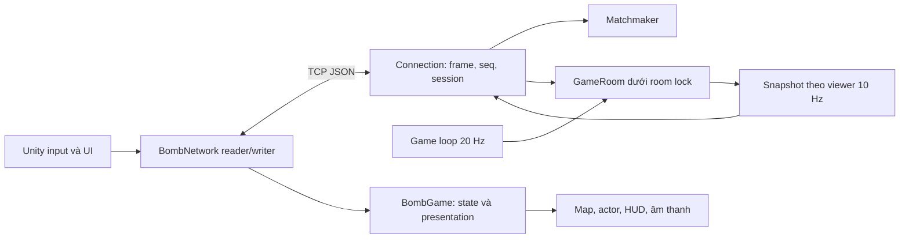
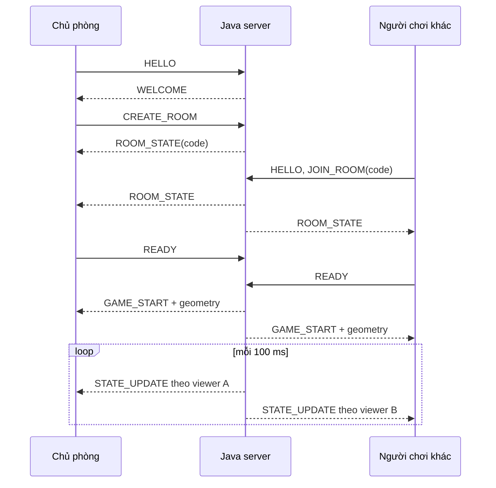
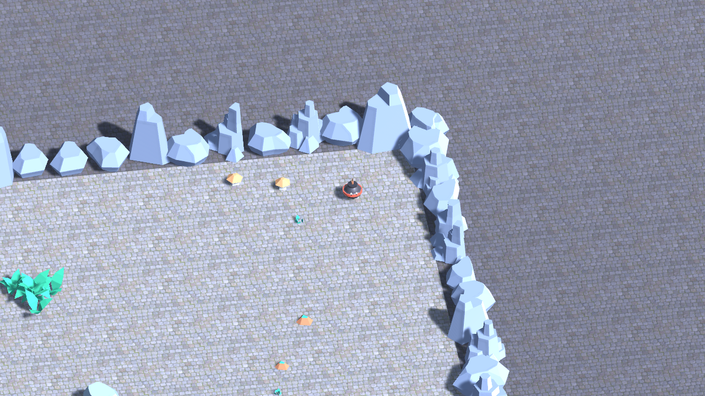

# Bomb Me Baby: trò chơi đấu trường nhiều người với đồng bộ trạng thái chọn lọc

**Bản nội dung để nhóm rà soát, cập nhật ngày 24/10/2026.** Chưa phải file Word đã nộp Compilatio. Cần điền số nhóm, lớp, họ tên/MSSV, thông tin giảng viên; kiểm tra lại phần đóng góp và bổ sung ảnh/playtest thật. Không tự suy ra các thông tin này từ tên tài khoản Git.

## Abstract

Bomb Me Baby giải quyết bài toán đồng bộ một trò chơi đấu trường nhiều người giữa Unity client và Java server. Client gửi ý định điều khiển; server giữ quyền quyết định vị trí hợp lệ, vật phẩm, sát thương, objective và kết quả. Hệ thống dùng TCP lâu dài với JSON phân cách bằng newline, mô phỏng 20 Hz và gửi snapshot 10 Hz. Cải tiến được đánh giá là đồng bộ chọn lọc: bỏ geometry tĩnh khỏi snapshot thường, lọc pickup theo khoảng cách và giấu tọa độ người chơi không nhìn thấy. Cơ chế phục hồi bổ sung session token, sequence, định danh phòng/vòng và phát lại kết quả kết thúc. Bản kiểm chứng có 107 test Java qua ở hai cấu hình, 12 kiểm tra C# và 111 kiểm tra Unity tự động; đã tạo Windows player và server JAR. Thực nghiệm loopback mới, dữ liệu lỗi trước sửa và các giới hạn được trình bày tách biệt; chưa dùng phép đo này để khẳng định hiệu năng trên Internet hoặc trải nghiệm của người thật.

**Keywords:** multiplayer game; authoritative server; TCP JSON; selective synchronization; reconnect; Unity.

## 1. Introduction

Một trò chơi nhiều người cần duy trì trạng thái nhất quán dù input đến đồng thời, client chậm hoặc kết nối tạm thời bị gián đoạn. Nếu client tự quyết định HP, vị trí hay người thắng, các máy có thể cho kết quả khác nhau. Nếu server gửi toàn bộ bản đồ và vật phẩm liên tục, chi phí truyền dữ liệu tăng dù phần lớn hình học không đổi.

Mục tiêu của dự án là xây dựng trò chơi PvP có thể demo với 2–4 người và hỗ trợ tối đa 10 người trong phòng riêng, đồng thời minh họa giao tiếp mạng, xử lý đồng thời, phục hồi lỗi và đánh giá một cải tiến định lượng. Đấu nhanh tối đa 180 giây: người sống cuối cùng thắng sớm, hết giờ còn nhiều người thì hòa. Hành trình gồm ba chương meadow, crossroads, crater, tranh Mảnh Tim Lửa và giữ kết quả qua chương.

Phạm vi không bao gồm tài khoản, cơ sở dữ liệu lịch sử trận, thanh toán hoặc dịch vụ vận hành quy mô lớn. Trạng thái phòng/session được lưu trong bộ nhớ; restart server làm mất phiên. Đồ họa và âm thanh hỗ trợ demo, không được dùng thay bằng chứng cho đóng góp kỹ thuật.

## 2. Background và Related Work

TCP cung cấp luồng byte có thứ tự và độ tin cậy; ứng dụng vẫn phải xác định ranh giới message. Dự án chọn một JSON object mỗi dòng, nên cần tích lũy tới newline nhưng giới hạn độ dài trước khi cấp phát quá mức. Việc dùng TCP không tự bảo vệ thứ tự nếu tầng ứng dụng tách event và snapshot sang hai hàng đợi rồi xử lý sai thứ tự. Cơ sở giao thức được đối chiếu với [RFC 9293](https://www.rfc-editor.org/rfc/rfc9293.html).

[Java ServerSocket](https://docs.oracle.com/en/java/javase/17/docs/api/java.base/java/net/ServerSocket.html) cung cấp điểm lắng nghe và chấp nhận kết nối. Dự án dùng blocking I/O, một reader trong pool và một writer riêng mỗi connection. Lựa chọn này dễ quan sát và kiểm thử ở quy mô đồ án; chưa đánh giá mô hình event loop/NIO khi số kết nối lớn.

[Unity JSON serialization](https://docs.unity3d.com/6000.3/Documentation/Manual/json-serialization.html) cho phép ánh xạ JSON có cấu trúc vào các lớp dữ liệu. DTO của dự án tách `ServerMessage` với `RoomEnvelope`, vì trường room của ROOM_STATE là object, trong khi một số event dùng mã phòng dạng chuỗi.

Tài liệu [Snapshot Interpolation của Glenn Fiedler](https://gafferongames.com/post/snapshot_interpolation/) mô tả việc tái dựng hình ảnh từ trạng thái được gửi qua mạng và các đánh đổi về băng thông/độ mượt. Client của dự án dự đoán hình ảnh ngắn hạn cho người chơi local, ngoại suy có giới hạn giữa hai snapshot cho người chơi khác và hiệu chỉnh mềm về trạng thái server. Cơ chế này chưa phải lag compensation hoàn chỉnh vì không tua lại lịch sử va chạm hoặc sát thương trên server.

## 3. Problem Definition

Input gồm HELLO, tạo/vào/rời phòng, tìm trận, READY, hướng di chuyển, nạp/nổ bom, Khiên, Boost và thả mảnh. Output gồm trạng thái phòng, snapshot, event gameplay, kết quả, ACK và PONG. Client không gửi HP hoặc vị trí tuyệt đối để server tin trực tiếp.

Các ràng buộc chính: ít nhất 2 người để bắt đầu; tối đa 10 người/phòng riêng, tối đa 4 người/nhóm tìm trận; 64 connection đồng thời; cửa sổ resume 10 giây; frame client tối đa 2048 ký tự UTF-16. Mạng demo là mạng tin cậy hoặc loopback; protocol chưa mã hóa TLS. Cấu hình baseline và optimized phải giữ cùng luật chơi để phép so sánh có ý nghĩa.

Điều kiện đúng gồm một người không thuộc hai phòng, vật phẩm không được trao hai lần, snapshot cũ không mở lại trận đã kết thúc, người reconnect nhận đủ geometry/kết quả và người bị che không bị lộ tọa độ qua các event tối ưu.

## 4. Proposed Approach

Server là nguồn trạng thái chính thức. Mỗi tick 50 ms, server xử lý timeout, di chuyển/va chạm, nhặt vật phẩm, lực đẩy, objective và điều kiện kết thúc. Mỗi hai tick gửi snapshot cho từng viewer. Input từ reader và update từ game loop cùng sử dụng monitor của room, nên phép biến đổi trạng thái được tuần tự hóa trong từng phòng.

Trong baseline, mỗi snapshot lặp lại đá, bụi, danh sách pickup và trạng thái người chơi. Trong optimized, geometry nằm trong GAME_START hoặc snapshot recovery; orb/Core chỉ được gửi trong phạm vi quan sát pickup, còn tọa độ người khuất bị thay bằng 0. Điều kiện nhìn thấy xét khoảng cách, bụi và thông tin công khai của objective. Đây là chọn lọc nội dung snapshot, không phải delta từng trường hay thuật toán mạng mới.

Gộp snapshot chỉ được thực hiện khi hai snapshot đứng liền nhau trong hàng đợi. Event tạo mốc thứ tự. Một snapshot recovery có geometry không bị thay bởi snapshot tối ưu không có geometry. Khi quá tải, đóng/reconnect với state đầy đủ thay cho âm thầm loại bỏ event vòng đời.

## 5. System Architecture

`BombServer` quản lý registry phòng, session, connection và lịch tick. `GameRoom` quản lý luật trận và dữ liệu map. `ShardObjective` quản lý mảnh, owner/carrier, phá ấn và thời gian chương. `BombNetwork` không gọi API dựng hình trên worker; main thread đọc hàng đợi rồi `BombGame` cập nhật presentation. Dự án không cần database cho phạm vi phiên chơi hiện tại.

## 6. Network Communication Design

Mọi frame là JSON UTF-8 phân cách bằng newline; reader chấp nhận LF hoặc CRLF. HELLO mở session hoặc yêu cầu resume bằng token. Trừ HELLO/PING, `seq` phải tăng trong cùng session; request lặp không được thực thi lại. ACK phản ánh thời gian xử lý server, không thay thế GAME_START/GAME_OVER hay xác nhận luật nghiệp vụ. PONG echo timestamp để đo RTT.

Phòng riêng chỉ nhận JOIN_ROOM theo mã. FIND_MATCH lấy người từ hàng chờ cùng mode và tạo phòng khác; đủ ít nhất hai người thì ghép ở tick tiếp theo. Khi tạo phòng, đăng ký và thêm host cùng room lock; cleanup cũng kiểm tra/xóa dưới lock để không sinh phòng có host nhưng mất registry.

Client gửi PING định kỳ; server đóng connection im lặng 6 giây, client phát hiện server im lặng 7 giây. Sau disconnect, session đã vào trận được giữ 10 giây. Resume PLAYING trả WELCOME, ROOM_STATE và full snapshot. Resume FINISHED còn phát lại GAME_OVER và JOURNEY_COMPLETE nếu có. Lobby bị xóa thì WELCOME.hasRoom=false và LEFT_ROOM đưa client về menu.

Snapshot có roomCode và roundIndex. Client chỉ áp dụng đúng phòng/vòng, không chấp nhận PLAYING khi vòng đã FINISHED. Chi tiết trường và mã lỗi ở `docs/PROTOCOL.md`.

## 7. Implementation và concurrency

Khóa theo thứ tự player → room → hàng đợi ghi; game loop không lấy player monitor trong room lock. Writer thực hiện I/O ngoài room lock. Hàng đợi server tối đa 128, client tối đa 256 message; lỗi quá tải dẫn tới phục hồi có kiểm soát. Giới hạn frame được áp dụng trong lúc đọc, trước khi tích lũy một dòng không giới hạn.

Một lỗi được bắt trong thực nghiệm là watchdog đọc `writeStartedAt` volatile hai lần: lần đầu thấy timestamp, lần sau thấy 0 do writer vừa xong, dẫn tới tính tuổi ghi từ epoch và đóng socket khỏe. Bản sửa chụp giá trị một lần. Test hai luồng thất bại trên code cũ và qua trên code mới; không chỉ tăng timeout để che triệu chứng.

Khi nhặt orb/Core làm tăng bán kính, server giải quyết chồng collider với đá/biên trước bước di chuyển sau. Trường hợp cụm đá làm phép chiếu dao động có tìm vị trí trống gần nhất bằng các vòng lấy mẫu. Boost chỉ sinh orb khi lượng size thực chi đủ giá trị orb. Hành trình xếp theo số mảnh, rồi số lần hạ, rồi người thắng chương cuối trong nhóm hòa; vẫn hòa thì đồng thắng. Client dùng winnerIds để phân biệt đồng thắng với người còn lại.

Hành trình thiếu người sau giữ chỗ reconnect 10 giây kết thúc sớm, chỉ tính các chương đã chơi. Phá ấn chỉ cộng thời gian sau khi nhân vật đã vào vòng tròn quanh bệ, tối đa 100 ms mỗi tick; deadline chương vẫn theo thời gian thực. Damage phản khiên cũng reset tiến độ phá ấn. Người chết ngừng gửi input gameplay; camera/audio và lọc dữ liệu optimized cùng theo một người sống do server chọn.

Presentation dùng vật liệu riêng cho actor, pickup và objective, giải phóng cùng đối tượng; cache dùng chung được giữ riêng. Hai vật liệu nền fallback được hủy khi thay bằng vật liệu có texture. Âm thanh dùng pool 20 giọng, nhạc cho từng map và hạ nền theo sự kiện; nhạc sảnh do người dùng chọn được giữ nguyên.

## 8. Experimental Setup

Thực nghiệm mới chạy ngày 22/10/2026 trên Windows 11, Java 21.0.10 (target Java 17), Maven 3.9.16 và Python 3.12.10. Unity build/validation dùng 6000.3.6f1. Server và client giả lập cùng máy, loopback cổng 17777. Cố định map meadow; MOVE 10 Hz, PING 1 Hz, seed input 1/2/3. Mỗi cấu hình 2/4/8 client lặp ba lần, mỗi lượt 30 giây. Server khởi động lại khi đổi sync mode.

Không cố định seed sinh orb/spawn của server, vì vậy cảnh động hai mode chưa giống hệt. Phép đo cũng không giả lập mất gói, băng thông Internet hay rendering Unity. Thông tin máy, fingerprint nguồn, raw CSV và bảng số liệu xem `docs/EXPERIMENTS_FINAL.md`; không lấy cấu hình phần cứng của mốc 19/10 để gán cho lần đo mới.

Lượt trước sửa watchdog được giữ ở `experiments/final-2026-10-22`, có lỗi và không dùng làm kết quả bản cuối. Phép đo sau sửa dùng thư mục `experiments/final-2026-10-22-v2`. Git describe ghi `-dirty`; SHA-256 source Java + pom phân biệt chính xác bản sửa chưa commit.

## 9. Results

| Lớp kiểm tra | Kết quả đã thực hiện | Giới hạn |
| --- | --- | --- |
| Java/JUnit | 107 test qua baseline và optimized | Chạy trên máy hiện tại |
| C# ngoài Unity | 12 kiểm tra hàng đợi/kết quả qua | Không đánh giá rendering |
| Unity Play Mode | 111 kiểm tra headless qua | Một Unity client + peer TCP; không phải hai Unity player |
| Vật liệu qua ba chu kỳ map | Test không tăng số vật liệu qua chu kỳ đã qua | Thời điểm hủy cuối frame ảnh hưởng số đếm; không phải tổng RAM/GC/FPS |
| Build | Windows player và server JAR tạo thành công | Chưa nghiệm thu máy sạch |

Benchmark ngày 22/10 sau sửa watchdog hoàn tất 18 lượt, không có ERROR/CONNECTION_LOST. Trung bình ba lượt trên mỗi cấu hình:

| Client | Baseline byte nhận/client/s | Optimized byte nhận/client/s | Giảm |
| --- | ---: | ---: | ---: |
| 2 | 94 850,4 | 20 777,0 | 78,1% |
| 4 | 101 530,6 | 26 110,8 | 74,3% |
| 8 | 115 042,9 | 43 546,6 | 62,1% |

Chưa benchmark lại sau sửa gameplay/protocol ngày 23–24/10; không gán số liệu này cho working tree hiện tại. Fingerprint nguồn đã đo: `698fbcb72a23e47ef29f1413490ae6dbabe9da9599fcc8d346f6175eb4029ab5`. Chi tiết RTT, phương pháp tính và raw CSV nằm ở `docs/EXPERIMENTS_FINAL.md`. RTT trung bình hai mode gần nhau; phép đo không chứng minh giảm độ trễ. Số liệu 66–79% trong tài liệu cũ chỉ thuộc ngày 19/10, không được gán lại cho bản cuối.

Hình: camera Unity render map crossroads khi chạy harness kiểm tra, dùng tài nguyên thật của dự án. Đây không phải concept AI, không có HUD và không phải ảnh chụp một trận người thật. Ảnh hai map còn lại nằm trong `docs/validation/`.

## 10. Discussion

Lợi ích băng thông kỳ vọng đến từ việc bỏ dữ liệu tĩnh lặp lại và lọc các pickup ngoài vùng quan sát. Số message không nhất thiết giảm vì tần suất snapshot và ACK không đổi. Khi tăng số người, phần trạng thái động tăng và có thể làm tỉ lệ tiết kiệm nhỏ hơn. Đây là giải thích cơ chế; kết luận định lượng phải dựa trên CSV của bản cuối.

RTT loopback nhỏ không chứng minh latency Internet tốt hơn. processingMicros bao gồm parse/xử lý tại server nhưng không bao trùm thời gian truyền, writer socket và dựng hình. Warm-up JVM, tải nền và cảnh ngẫu nhiên có thể ảnh hưởng từng lượt. Không lựa chọn riêng các lượt đẹp rồi bỏ dấu vết lượt lỗi.

## 11. Novelty and Contributions

| Đóng góp trong phạm vi dự án | Bằng chứng |
| --- | --- |
| Đồng bộ chọn lọc so với snapshot đầy đủ | Hai nhánh baseline/optimized trong GameRoom; CSV cùng map và cùng fingerprint nguồn |
| Phục hồi trạng thái giữ thứ tự vòng đời | Regression hàng đợi, roundIndex, test TCP resume ở các phase |
| Kiểm chứng kết hợp server và Unity | JUnit, C# harness, Unity Play Mode qua TCP thật, script tái chạy và log |

Nhóm không tuyên bố phát minh TCP, snapshot hay interest management. Điểm đóng góp là triển khai, đối chiếu với baseline và kiểm chứng trong trò chơi cụ thể. Lịch sử tác giả/commit giữ theo `TEAM_PLAN.md`; các sửa đổi tích hợp chưa commit không được tự gán cho thành viên khác.

## 12. Limitations và Future Work

Chưa có TLS/tài khoản, lưu lịch sử, chống gian lận toàn diện hoặc rate limit theo client. Một người gửi rất nhanh vẫn có thể tiêu tốn CPU; giới hạn connection/frame/queue không thay thế rate limit. Client chỉ có prediction/reconciliation hình ảnh ngắn hạn, không dự đoán hit, pickup hoặc sát thương; quan sát sau khi chết hiện tự chọn mục tiêu, chưa có chuyển mục tiêu thủ công. Map seed chưa được khóa để so sánh hai mode trên cảnh giống hệt.

Cần tiếp tục: playtest 2–4 Windows client, đo FPS/GC trên máy yếu, kiểm tra LAN hai máy và tình huống mạng kém; bổ sung rate limit nếu public server; thử nghiệm seed cố định và các mức latency có kiểm soát. Nếu mở rộng số phòng lớn, đánh giá NIO hoặc mô hình reader khác dựa trên profiling.

## 13. Conclusion

Dự án cung cấp một trò chơi mạng có server quyết định luật, hai chế độ chơi, ba map, tìm trận/phòng mã và phục hồi session. Cải tiến được đánh giá là đồng bộ chọn lọc với baseline có thể chạy lại. Kiểm thử đã phát hiện và sửa lỗi thứ tự snapshot, phục hồi kết quả, va chạm tăng kích thước và timeout giả; build cùng các script tái kiểm chứng đã được chuẩn bị. Phạm vi xác nhận chưa bao gồm trải nghiệm người thật và nghiệm thu ngoài máy hiện tại.

## References

1. W. Eddy (editor), *Transmission Control Protocol (TCP)*, RFC 9293, 2022. https://www.rfc-editor.org/rfc/rfc9293.html
2. Oracle, *Java SE 17: ServerSocket*. https://docs.oracle.com/en/java/javase/17/docs/api/java.base/java/net/ServerSocket.html
3. Unity Technologies, *Unity 6.3 Manual: JSON serialization*. https://docs.unity3d.com/6000.3/Documentation/Manual/json-serialization.html
4. Glenn Fiedler, *Snapshot Interpolation*, 2014. https://gafferongames.com/post/snapshot_interpolation/
5. Tài liệu đồ án của giảng viên: `final-project/Instruction.md`, `Topics.md`, `Submission.md` trong bộ Source.
6. Mã nguồn và bằng chứng dự án: `GameRoom.java`, `BombServer.java`, `BombNetwork.cs`, `BombValidation.cs`, `docs/FINAL_VALIDATION.md`, `docs/EXPERIMENTS_FINAL.md` và raw CSV đi kèm.

Nguồn 1–4 được mở đối chiếu ngày 22/10/2026. Nguồn tài nguyên hình/âm và điều kiện sử dụng ghi riêng trong `ASSET_CREDITS.md`, `AUDIO_CREDITS.md`. Nội dung, code và kiểm tra tích hợp có AI hỗ trợ; nhóm phải đọc, xác nhận và tự giải thích khi bảo vệ. Không coi bản nháp này là kết quả kiểm tra similarity.

## Appendix: trước khi nộp

Điền thông tin nhóm; chèn screenshot game chạy thật; đối chiếu các con số với raw CSV; chuyển bản nội dung đã duyệt sang `NhomXX_BombMeBaby_Report.docx`; kiểm tra Compilatio theo quy định; đặt đúng file đã nộp vào Report. Bộ đóng gói hiện tại là bản review cho nhóm, không tự gửi/nộp thay nhóm.
