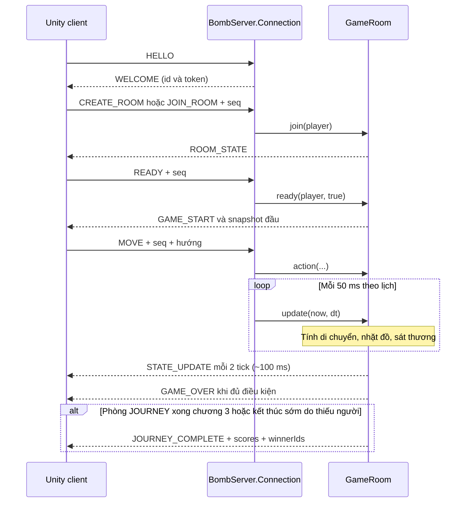

# Thành viên A — Học và hiểu phần Java server từ đầu

Cập nhật ngày 23/10/2026. Đọc cùng [README](../README.md), [bàn giao cho T và B](THANH_VIEN_A_BAN_GIAO.md), [kiểm chứng hiện tại](FINAL_VALIDATION.md) và [mốc kiểm thử 21/10](THANH_VIEN_A_KIEM_THU.md).

Tài liệu này giải thích code thực tế trong thư mục `server/`. Nó thay thế bản hướng dẫn cũ có một số mô tả chưa đúng với code. Không cần hiểu toàn bộ Java trước khi đọc; hãy đi lần lượt từ mục 1 đến mục 6, chạy test, rồi đọc sâu phần khóa và đồng bộ.

## 1. Bạn phụ trách gì?

Bạn A phụ trách chương trình Java chạy trên máy chủ: nhận kết nối, tạo/vào/rời phòng, giữ trạng thái trận, nhận hành động, xử lý mất kết nối và gửi kết quả cho Unity. Bạn cũng viết test chứng minh server xử lý đúng và duy trì hai chế độ đồng bộ để B so sánh.

T phụ trách Unity: đọc bàn phím, vẽ game, phát âm thanh, hiển thị HUD và xử lý bản tin server. B phụ trách map, script đo mạng và số liệu thực nghiệm. Khi đổi tên trường, bỏ trường hay đổi ý nghĩa dữ liệu JSON, cả ba phải thống nhất trước khi tích hợp.

**Kết quả hiện tại:** server đã có Đấu nhanh và Hành trình Ba Mảnh, sửa vòng đời reconnect/disconnect, chặn sequence trùng, xử lý tranh Core và giữ hai chế độ đồng bộ để đo. Hành trình chạy ba map cố định, giữ điểm qua ba vòng và phát kết quả cuối. Unity đã có DTO, hai loại phòng, bảng điểm, lời dẫn/VFX, nhạc/SFX, banner reconnect và debug server/sync/map. Bản Windows cuối vẫn cần playtest 2–4 client thật.

## 2. Những từ cần biết

| Từ | Hiểu đơn giản | Ví dụ trong dự án |
| --- | --- | --- |
| Client | Chương trình người chơi sử dụng | Game Unity trên máy bạn |
| Server | Chương trình giữ kết quả chính thức | `BombServer` chạy bằng Java |
| TCP | Kênh truyền byte có thứ tự, đáng tin cậy khi kết nối còn hoạt động | Socket giữa Unity và Java |
| Socket | Một đầu của kết nối mạng | `Socket socket` trong `Connection` |
| JSON | Văn bản có cặp tên và giá trị | `{"type":"MOVE","seq":5}` |
| Protocol | Quy ước hai phía hiểu dữ liệu như thế nào | `MOVE` cần hướng, không nhận tọa độ tự khai báo |
| Session | Phiên của một người chơi, có thể tồn tại qua nhiều socket | `PlayerState` cùng `resumeToken` |
| Room | Một nhóm người chơi chung trận | `GameRoom` |
| State | Dữ liệu hiện tại | HP, tọa độ, Core, giai đoạn trận |
| Tick | Một lần server tính diễn biến | Mục tiêu mỗi 50 ms |
| Snapshot | Bản chụp dữ liệu tại một thời điểm | `STATE_UPDATE` |
| Thread | Một luồng công việc có thể chạy cùng luồng khác | Luồng đọc socket và luồng game |
| Race condition | Kết quả sai do các luồng xen kẽ ở thời điểm không phù hợp | Hai socket cùng nhận một session |
| Lock/monitor | Quyền vào một vùng xử lý, mỗi lúc một luồng giữ | `synchronized (room)` |
| Baseline | Cách làm dùng làm mốc so sánh | Gửi map tĩnh trong mỗi snapshot |
| Culling | Bỏ bớt dữ liệu không cần gửi cho người nhận | Không gửi Core cách người nhận hơn 30 đơn vị |

Một số cú pháp Java bạn sẽ gặp:

```java
PlayerState p = new PlayerState("An", null);
```

`PlayerState` là kiểu dữ liệu; `p` là tên biến; `new` tạo một đối tượng. `p.hp` là HP của đối tượng đó. `null` nghĩa là chưa có đối tượng được tham chiếu; trong test, người chơi thường không có kết nối thật.

`if` kiểm tra điều kiện, `for` lặp, `return` kết thúc hàm, `!` là phủ định, `&&` yêu cầu cả hai điều kiện đúng. `==` so sánh giá trị nguyên thủy hoặc danh tính đối tượng; khi so sánh nội dung chuỗi Java thường dùng `.equals()`.

`Map<String, PlayerState>` giống danh bạ: dùng chuỗi token để tìm người chơi. `List<PlayerState>` là danh sách người trong phòng. `final` ngăn gán lại biến tham chiếu, **không** khiến mọi dữ liệu bên trong đối tượng trở thành bất biến.

## 3. Bản đồ các file

| File | Nên tìm hàm/biến nào? | Vai trò |
| --- | --- | --- |
| [BombServer.java](../server/src/main/java/bombmebaby/BombServer.java) | `main`, `run`, `Connection.run`, `handle`, `resume`, `disconnect`, `withSessionState` | TCP, session, điều phối request, vòng đời kết nối |
| [PlayerState.java](../server/src/main/java/bombmebaby/PlayerState.java) | `connection`, `room`, `lastSeq`, `connected`, `disconnectedAt` | Dữ liệu của một người chơi |
| [GameRoom.java](../server/src/main/java/bombmebaby/GameRoom.java) | `join`, `leave`, `ready`, `start`, `action`, `update`, `pickupCores`, `snapshot` | Phòng, luật diễn biến trận, bản tin trạng thái |
| [GameRules.java](../server/src/main/java/bombmebaby/GameRules.java) | `RECONNECT_MS`, `MIN_SPAWN_DISTANCE`, `damage` | Hằng số và công thức game |
| [GameMode.java](../server/src/main/java/bombmebaby/GameMode.java) | `QUICK`, `JOURNEY`, `fromProtocol` | Chế độ phòng và cách đọc trường mode |
| [SyncMode.java](../server/src/main/java/bombmebaby/SyncMode.java) | `BASELINE`, `OPTIMIZED`, `active` | Chọn cách đồng bộ |
| [ConnectionTest.java](../server/src/test/java/bombmebaby/ConnectionTest.java) | Các hàm có `@Test` | Kiểm tra bằng socket TCP thật trên máy |
| [ServerFixesTest.java](../server/src/test/java/bombmebaby/ServerFixesTest.java) | Core, timeout, snapshot | Kiểm tra trạng thái phòng và hai chế độ |
| [GameRoomTest.java](../server/src/test/java/bombmebaby/GameRoomTest.java) | Movement, shield, spawn, game over | Kiểm tra gameplay, có cả hồi quy spawn 10 người |

`GameMap.java` là dữ liệu ba bản đồ do B phụ trách. Đợt sửa này không đổi layout map hay công thức sát thương.

## 4. Theo dõi một trận từ đầu đến cuối



Luồng ví dụ:

1. Unity mở TCP đến IP server, cổng mặc định `7777`.
2. `Connection.run()` đọc từng dòng. `JsonParser` biến dòng chữ thành JSON để Java truy cập.
3. `HELLO` đầu tiên tạo session hoặc yêu cầu nối lại session cũ.
4. `CREATE_ROOM` tạo phòng; `JOIN_ROOM` tìm phòng theo mã. Server trả `ROOM_STATE` để Unity hiển thị danh sách người chơi.
5. Khi mọi người đã sẵn sàng và còn kết nối, `ready()` gọi `start()`.
6. `MOVE` chỉ đặt hướng `dx`, `dz`. `update()` mới dùng thời gian `dt` và tốc độ để tính vị trí, kiểm tra vật cản.
7. `snapshot()` tạo dữ liệu gửi cho từng người. Unity nhận và nội suy hình ảnh cho mượt.
8. Người cuối cùng còn sống thắng sớm. Phòng một người không thể bắt đầu. Đấu nhanh hòa sau 180 giây nếu còn nhiều người; Hành trình xét chủ bệ/người cầm mảnh khi hết 180 giây.

Ba giai đoạn phòng là `WAITING` (chờ), `PLAYING` (đang chơi), `FINISHED` (đã kết thúc vòng). Với Đấu nhanh, sẵn sàng lại bắt đầu vòng ngẫu nhiên mới. Với Hành trình, sẵn sàng lại sau chương 1/2 chuyển sang chương kế tiếp; sau chương 3 server không cho bắt đầu vòng thứ tư.

**Điểm phải nhớ:** game loop là 20 Hz, snapshot định kỳ là 10 Hz. Ngoài lịch định kỳ, server còn gửi snapshot ngay lúc bắt đầu và khi reconnect. Không viết trong báo cáo rằng mọi snapshot được gửi mỗi 50 ms.

### 4.1. Hành trình Ba Mảnh hoạt động thế nào?

Client tạo phòng bằng `CREATE_ROOM` với `mode="JOURNEY"`. Nếu bỏ trống mode, server dùng `QUICK` để client cũ vẫn chạy. Mode sai nhận `INVALID_MODE`.

| `chapterIndex` | Map | Tên chương |
| --- | --- | --- |
| 0 | `meadow` | Mảnh Mầm |
| 1 | `crossroads` | Mảnh Đường |
| 2 | `crater` | Mảnh Nhiệt |

Mỗi lần loại trực tiếp một đối thủ bằng vụ nổ hoặc phản khiên được 1 điểm. Người thắng chương (sống sót cuối cùng hoặc giữ mảnh khi hết giờ) nhận thêm 3 điểm và một `roundWins`. Khi vòng kết thúc, server gửi `GAME_OVER` kèm bảng `scores`. Người chơi READY lại để sang chương kế tiếp; `start()` reset HP, Size, cooldown và số kill của vòng nhưng không xóa điểm hành trình.

Sau chương 3, `selectJourneyWinners()` xếp theo thứ tự:

1. Số mảnh `roundWins` cao nhất.
2. Nếu hòa, số lần hạ `eliminations` cao nhất. `points` chỉ để thống kê.
3. Nếu vẫn hòa, người thắng vòng cuối được ưu tiên khi nằm trong nhóm hòa.
4. Nếu vẫn không tách được, trả nhiều id trong `winnerIds`; `winnerId` để rỗng.

Server phát `JOURNEY_COMPLETE` gồm `mode`, `chapterIndex`, `scores`, `winnerId` và `winnerIds`. `mode`, `chapterIndex`, `scores` cũng có trong `ROOM_STATE`, `GAME_START` và `STATE_UPDATE`, nên reconnect vẫn lấy được tiến độ hiện tại.

Điểm được giữ trong `journeyScores`, không nằm trong Unity. Người vào phòng bị chặn sau khi hành trình đã bắt đầu để không chen vào giữa chương. Người mất mạng giữa hai chương vẫn có 10 giây reconnect; hết hạn bị rời danh sách. Điểm đã ghi vẫn nằm trong kết quả hành trình. Còn dưới hai người tham gia sau giữ chỗ thì kết thúc sớm với `INSUFFICIENT_PLAYERS`, không mời READY; nếu đủ người thì READY để đi tiếp.

## 5. Vì sao client không tự quyết định nhặt Core?

Nếu Unity được tự gửi “tôi có 999 HP” rồi server tin ngay thì người chơi có thể sửa client để gian lận. Ở đây client chỉ gửi ý định như đi sang phải, bắt đầu nạp hoặc nổ. Server tự tính HP, va chạm, ai chết và ai nhặt Core. Đó là mô hình **server authoritative**.

Đọc `pickupCores()` trong `GameRoom.java`:

```java
if (!p.alive || !p.connected) continue;
double distance = GameRules.distance(p.x, p.z, core.x, core.z);
if (distance < 0.55 * p.size + 0.45 && distance < bestDistance) {
    closest = p;
    bestDistance = distance;
}
```

Đoạn này tìm người **gần nhất trong số người đủ điều kiện**, không phải ai gửi request nhanh nhất. Nếu hai người có khoảng cách bằng nhau, người xuất hiện trước trong danh sách phòng giữ ưu tiên vì điều kiện là `<`, không phải `<=`.

Sau khi tìm được người nhận:

```java
cores.remove(i);
closest.baseSize = Math.min(GameRules.MAX_BASE, closest.baseSize + 0.1);
closest.size = Math.max(closest.size, closest.baseSize);
```

Core được xóa và chỉ một người tăng Base Size. Hàm này được gọi trong `update()` đang giữ khóa phòng, nên luồng khác không thể chen vào giữa để cùng nhặt Core. Bản tin thực tế là `CORE_PICKED` với `pickupId`, không phải `coreId`.

Quy tắc chọn người gần nhất và khóa phòng đã có trong code đầu vào. Đợt này bổ sung test cạnh tranh hai tick, khoảng cách bằng nhau, ngoài tầm và người không đủ điều kiện; không nhận phần có sẵn thành thuật toán mới.

## 6. Request trùng và số thứ tự `seq`

Giả sử người chơi gửi:

```json
{"type":"MOVE","seq":5,"directionX":1,"directionZ":0}
```

Server lưu `lastSeq = 5`. Nếu cùng session gửi lại `seq = 5` hoặc gửi `seq = 3`, server trả `DUPLICATE_SEQUENCE` và không thực hiện hành động. `seq = 6` được xét tiếp.

```java
if (seq <= player.lastSeq) { error("DUPLICATE_SEQUENCE"); return; }
player.lastSeq = seq;
```

Sequence không cần liên tục: 5 rồi 8 vẫn được. Nó phải tăng trong toàn bộ session, không reset khi rời phòng hay reconnect. `HELLO` đầu tiên xử lý riêng; `PING` không làm tăng `lastSeq`.

TCP đã tự xử lý mất gói và truyền lại ở tầng giao vận. Ứng dụng thường không nhận các byte trùng chỉ vì TCP truyền lại. `seq` bảo vệ trước việc **ứng dụng gửi lại request**, client lỗi hoặc thử gửi lệnh cũ.

`lastSeq` được cập nhật trước khi kiểm tra mọi điều kiện gameplay. Một request mới nhưng không hợp lệ trong tình trạng hiện tại vẫn có thể tiêu thụ sequence. Client nên luôn tăng số khi gửi request tiếp theo.

**ACK không đồng nghĩa hành động thành công:** server hiện gửi ACK cả sau nhiều trường hợp ERROR. ACK có `seq` và `processingMicros` để phản hồi việc xử lý; phải đọc ERROR để biết hành động bị từ chối. Đợt này giữ nguyên quy ước đó để không tự đổi protocol.

## 7. Reconnect và disconnect được sửa như thế nào?

### 7.1. Phân biệt socket và session

Socket cũ mất đi không có nghĩa session phải mất ngay. `sessions` lưu người chơi theo `resumeToken`. Unity có thể mở socket mới rồi gửi:

```json
{"type":"HELLO","resumeToken":"token-da-nhan-truoc-do"}
```

Nếu session đã ngắt và chưa hết thời hạn 10 giây, server gắn socket mới vào cùng `PlayerState`: giữ id, phòng, HP và sequence. Server không hồi sinh người đã bị loại chỉ vì họ reconnect.

Thời hạn tính từ lúc **server phát hiện ngắt kết nối** và ghi `disconnectedAt`, không nhất thiết từ lúc Wi-Fi thực sự mất. Server đóng kết nối không nhận message trong 6 giây hoặc write treo 3 giây; client phát hiện server im lặng sau 7 giây. MOVE cũ hết hiệu lực sau 0,5 giây, còn PING duy trì kết nối khi đứng yên/quan sát.

### 7.2. Lỗi còn sót trong bản đầu vào

Bản cũ đã khóa lúc nhận token, nhưng disconnect làm hai bước tách rời: đánh dấu session ngắt dưới khóa player, sau đó mới lấy khóa room để xóa hướng đi hoặc rời phòng. Reconnect có thể chen giữa hai bước. Khi kết nối mới đã hoạt động, kết nối cũ vẫn có thể xóa hướng đi hoặc sửa phòng của nó.

### 7.3. Vùng xử lý chung cho vòng đời kết nối

`withSessionState()` lấy khóa theo một thứ tự:

```text
khóa PlayerState → khóa GameRoom (nếu có) → khóa hàng đợi gửi Connection
```

`disconnect()` và `resume()` cùng đi qua vùng khóa này. Disconnect chỉ tác động nếu nó vẫn sở hữu session:

```java
if (player.connection != this) return;
```

`this` ở đây là đối tượng Connection đang chạy. Nếu session đã có Connection mới, dọn dẹp muộn của Connection cũ không được thay đổi nó.

Ở lobby chưa bắt đầu, disconnect rời phòng. Phòng đã bắt đầu giữ chỗ 10 giây cả khi PLAYING/FINISHED hoặc Hành trình hoàn tất; hết hạn được dọn, phòng rỗng bị xóa. Khi mất kết nối, hướng đi/nạp về trạng thái dừng và phòng nhận PLAYER_DISCONNECTED.

Khi resume, khóa phòng được giữ đến lúc xếp `WELCOME`, `ROOM_STATE` và snapshot khôi phục vào hàng đợi; writer thực hiện socket I/O ngoài khóa phòng. Nhờ vậy game loop không gửi snapshot định kỳ trước `WELCOME`. Hai socket tranh cùng token chỉ có một socket thành công.

Token không tồn tại cũng trả `RESUME_FAILED`, thay vì âm thầm tạo người chơi mới dù client đang yêu cầu khôi phục người cũ. Muốn bắt đầu session mới, client gửi HELLO không có token.

Mốc thời gian được thống nhất: **nhỏ hơn 10.000 ms** mới được resume; từ 10.000 ms trở lên là hết hạn. Trước đây resume dùng `<=` trong khi tick dùng `>=`.

### 7.4. Nhận lại sequence và map

WELCOME khi resume có `lastSeq`. Ví dụ server đã xử lý 10, request tiếp theo phải lớn hơn 10. `BombProtocol.cs` đã khai báo trường này và `BombNetwork.ContinueSequenceAfter()` đưa bộ đếm client lên ít nhất bằng giá trị server trả về.

Snapshot khôi phục gọi `snapshot(..., includeStaticGeometry=true)`: có lại toàn bộ `obstacles` và `bushes`, nhưng optimized vẫn che tọa độ player vô hình và vẫn cull pickup xa. Geometry đầy đủ không còn đồng nghĩa tắt luật visibility.

### 7.5. Hết hạn ngắt kết nối

`GameRoom.update()` giờ xử lý tất cả người hết hạn trước khi xét thắng/thua hoặc nổ tự động. Nếu cả hai người cùng hết hạn, cả hai bị loại, không chọn nhầm một người đã hết hạn làm người thắng. Khi không có người sống, `winnerId` là chuỗi rỗng theo protocol hiện có.

## 8. Hiểu đa luồng và khóa trong code

Server dùng `Executors.newFixedThreadPool(64)` để xử lý Connection; không phải `newCachedThreadPool`. Mỗi Connection đang chạy chiếm một worker đọc socket. Server từ chối connection mới khi đủ 64 kết nối; mỗi connection còn có writer riêng. Đây không phải thiết kế hỗ trợ vô hạn người chơi.

Game loop có một luồng định thời riêng, lần lượt cập nhật các phòng. Trong cùng phòng, `join`, `leave`, `ready`, `action`, `update`, `snapshot` và `roomInfo` dùng `synchronized`.

```java
synchronized void update(long now, double dt) { ... }
```

Tương đương lấy khóa `this`, mà `this` ở đây là phòng hiện tại. Luồng MOVE và luồng tick muốn sửa cùng phòng phải chờ nhau. Hai phòng có khóa khác nhau, nhưng vẫn dùng chung một luồng tick của server.

`volatile` trên `connection`, `room`, `connected` giúp luồng khác thấy giá trị được công bố. Nó **không thay thế khóa** cho thao tác gồm nhiều bước. Ví dụ kiểm tra session rảnh rồi nhận session vẫn phải làm trong vùng khóa chung.

Để tránh deadlock, không thêm đoạn lấy khóa player bên trong phương thức GameRoom đang giữ khóa room. Việc đảo thứ tự room → player sẽ xung đột với player → room của vòng đời kết nối.

Mỗi connection có writer nền và hàng đợi tối đa 128 message; chỉ gộp snapshot liền nhau, giữ thứ tự event. Socket I/O không chạy dưới khóa phòng/session. Queue đầy hoặc write treo dẫn đến đóng connection đó. Cơ chế này có test, nhưng chưa thay cho đo tải/mạng LAN kém bằng nhiều Unity client.

## 9. Cải tiến đồng bộ: nói đúng tên, đo đúng thứ

| Nội dung | Baseline | Optimized hiện có |
| --- | --- | --- |
| Tần suất tính game | 20 Hz | 20 Hz |
| Snapshot định kỳ | 10 Hz | 10 Hz |
| Đá và bụi trong snapshot | Có mỗi lần | Bỏ ở snapshot thường; có trong GAME_START và snapshot khôi phục |
| Đối thủ không nhìn thấy | `visible=false` nhưng vẫn có tọa độ thật | `visible=false`, `x=0`, `z=0` trong snapshot thường |
| Orb/Core | Gửi tất cả | Gửi vật phẩm cách viewer tối đa 30 đơn vị |
| Players và các trường động | Gửi lại mỗi snapshot | Vẫn gửi lại mỗi snapshot |

Đây là **selective state synchronization**: tách dữ liệu tĩnh và lọc theo người nhận. Chưa phải delta encoding đầy đủ vì chưa so snapshot mới/cũ, chưa gửi riêng các trường thay đổi hay danh sách id bị xóa giữa hai tick.

`0,0` là tọa độ thay thế khi `visible=false`, không phải vị trí thật của đối thủ. Culling chỉ thay danh sách gửi đi, không xóa đồ vật trong thế giới server. Khi người chơi tiến lại gần, vật phẩm xuất hiện lại trong snapshot nếu nó còn tồn tại.

Trong `snapshot()`:

```java
boolean optimized = !forceBaselineData && syncMode == SyncMode.OPTIMIZED;
```

`includeStaticGeometry` chỉ quyết định có kèm đá/bụi; reconnect bật cờ này nhưng không tắt privacy. `forceBaselineData` chỉ được overload bốn tham số dùng cho phép so sánh baseline có kiểm soát trong test. Constructor nhận `SyncMode` giúp test tạo cả hai chế độ trong cùng lần chạy.

Đợt này còn sửa `List.copyOf(orbs)` và `List.copyOf(cores)`: snapshot giữ bản sao danh sách vật phẩm. Nếu tick sau xóa đồ vật, snapshot đã tạo không bị đổi theo trong lúc chuẩn bị ghi JSON.

Trong optimized, `PLAYER_EXPLODE` được tạo riêng cho từng viewer: người không nhìn thấy nguồn nổ nhận `visible=false`, `x=0`, `z=0`, và Unity không dựng VFX tại tọa độ thay thế. `CORE_SPAWNED` chỉ được gửi cho viewer trong 30 đơn vị; người ở xa sẽ thấy Core khi snapshot culling cho phép. Không nên gọi đây là chống gian lận toàn diện vì server chưa có xác thực/TLS và những event không có tọa độ vẫn có thể để lộ một phần diễn biến.

## 10. Thay đổi mới so với commit dc255a3

| Phần | Đã có trong commit đầu vào | Bổ sung/sửa trong đợt này |
| --- | --- | --- |
| Reconnect | Khóa lúc nhận token, WELCOME.lastSeq, full snapshot | Khóa chung toàn vòng đời, ngăn cleanup cũ tác động phiên mới, thứ tự bản tin khôi phục |
| Token và timeout | Có resume token, cửa sổ 10 giây | Token lạ bị từ chối; thống nhất điều kiện hết hạn |
| Room | Tạo/vào/rời phòng | `putIfAbsent` tránh ghi đè mã phòng trùng; join không vào phòng vừa bị xóa; dọn lobby rỗng khi disconnect |
| Kết thúc trận | Loại người hết hạn | Loại toàn bộ người hết hạn trước khi chọn thắng/thua |
| Core | Người gần nhất, khóa room | Test cạnh tranh và các điều kiện nhận Core |
| Đồng bộ | BASELINE/OPTIMIZED và culling | Chọn mode tường minh cho test; snapshot không dùng chung danh sách pickup có thể thay đổi |
| Spawn | Chọn vị trí bằng greedy farthest-point | Thử lại tối đa 96 điểm bắt đầu nếu bố trí bị kẹt; giữ khoảng cách tối thiểu 28 |
| Hành trình | Chưa có | QUICK/JOURNEY, ba map cố định, điểm loại/thắng vòng, tie-break và `JOURNEY_COMPLETE` |
| Unity protocol/UI | Chưa nhận mode/điểm; chưa dựng map từ GAME_START | DTO mới, nút tạo hai mode, bảng điểm, event cuối và cache geometry từ GAME_START |
| Test | 27 test; vài test chỉ tự lặp điều kiện | 107 test ở bộ hiện tại, gồm 30 test Connection, luật trận/objective, bot và hồi quy; xem FINAL_VALIDATION.md |
| Hướng dẫn | Có mô tả chưa khớp code | Viết lại theo code, thêm cách học, lệnh chạy, bằng chứng và giới hạn |

Lỗi spawn xuất hiện khi chạy test: `Cannot separate 10 spawns on map meadow`. Một lựa chọn đầu tiên không tốt có thể làm thuật toán tham lam không xếp đủ người dù map còn cách bố trí hợp lệ. Thử lại giúp xử lý trường hợp đó mà không hạ khoảng cách; test kiểm tra 20 seed × 3 map. Đây là kiểm tra hữu hạn, không phải chứng minh toán học cho mọi seed.

## 11. Chạy trên máy bạn

Mở Terminal trong IntelliJ hoặc PowerShell ở thư mục dự án. Chỉ chạy `cd server` một lần nếu bạn đang đứng ở thư mục gốc:

```powershell
cd server
java -version
mvn -version
mvn clean test
```

`mvn` là Maven, công cụ tải thư viện, biên dịch và chạy test. Dự án biên dịch với Java release 17; máy kiểm tra dùng JDK 21.0.10 và Maven 3.9.16. Lần đầu Maven có thể cần mạng để tải thư viện.

Kết quả đã xác nhận ở bản hiện tại là `Tests run: 107, Failures: 0, Errors: 0, Skipped: 0` rồi `BUILD SUCCESS`. Số test sẽ tăng khi bổ sung ca mới; không coi con số cũ là điều kiện bắt buộc để build.

Chạy từng nhóm để học:

```powershell
mvn test "-Dtest=ConnectionTest"
mvn test "-Dtest=ServerFixesTest"
mvn test "-Dtest=GameRoomTest"
```

Chạy server baseline cho Unity hiện tại và cho B đo:

```powershell
mvn compile exec:java "-Dexec.args=7777" "-Dsync.mode=baseline"
```

Terminal này sẽ tiếp tục chạy server. Giữ nó mở, dùng terminal khác hoặc Unity để kết nối. Dừng server bằng Ctrl+C.

Kiểm tra mode optimized bằng test, chưa cần Unity:

```powershell
mvn test "-Dsync.mode=optimized"
```

Unity hiện đã tích hợp optimized. Khởi động server ở chế độ này bằng:

```powershell
mvn compile exec:java "-Dexec.args=7777" "-Dsync.mode=optimized"
```

`-Dsync.mode=...` là **Java system property**, không phải biến môi trường. Nó được đọc khi lớp SyncMode khởi tạo; muốn đổi mode thì khởi động lại tiến trình. Xem log `[SyncMode] active = ...` để xác nhận. Giá trị không nhận ra hiện quay về baseline.

Nếu `mvn` không được nhận diện, kiểm tra PATH trong terminal và cấu hình Maven/JDK của IntelliJ. Nếu báo cổng đã được dùng, dừng server cũ hoặc đổi cả cổng server và client. Nếu lỗi khi chạy optimized trên Unity, xem phần bàn giao cho T trước; test Java pass không chứng minh Unity đã tương thích.

## 12. Đọc test như đọc một thí nghiệm

Mỗi test có ba phần: dựng tình huống → gọi code thật → so kết quả mong đợi. `assertEquals` yêu cầu bằng nhau, `assertTrue` yêu cầu đúng, `assertFalse` yêu cầu sai. Khi một điều kiện không đúng, Maven báo test thất bại để mình tìm nguyên nhân.

Ví dụ `simultaneousResumeAllowsExactlyOneTcpConnection` tạo hai socket, dùng `CountDownLatch` cho hai luồng cùng gửi HELLO, rồi đọc phản hồi: một WELCOME, một RESUME_FAILED. Nó đi qua chính `Connection.run()` và `handle()` của sản phẩm. Không chỉ tự viết lại biểu thức kiểm tra token trong test.

`equalDistanceCoreIsAwardedOnceAcrossConcurrentTicks` cho hai luồng cùng gọi `update()` và kiểm tra chỉ một người tăng Base Size. `Future.get()` có timeout giúp test thất bại nếu luồng bị kẹt, đồng thời đưa ngoại lệ từ luồng phụ về luồng test.

Các test timeout truyền mốc thời gian cho room, hoặc đặt thời điểm ngắt trong fixture; không cần ngồi chờ đủ 10 giây. Fixture là dữ liệu/đối tượng dựng riêng cho test, không phải dữ liệu giả để báo cáo benchmark.

## 13. Lộ trình tự học và thực hành

1. Đọc mục 2–4, tự kể lại đường đi của MOVE từ Unity đến snapshot.
2. Mở `PlayerState`, tìm trường ứng với tọa độ, HP, token và sequence.
3. Chạy `ConnectionTest`; đọc test reconnect và request trùng cùng code `handle()`.
4. Đọc `update()` và `pickupCores()`; giải thích vì sao chỉ một người nhận Core.
5. Chạy `ServerFixesTest`; xem test byte và so hai snapshot của cùng một room.
6. Đọc test `threeFragmentJourneyUsesFixedMapsScoresAndFinalRoundTieBreak`, tự ghi lại điểm của A/B/C sau từng chương.
7. Mở Unity với T, tạo phòng Hành trình và chơi đủ ba chương bằng hai client. Test Java là bằng chứng tự động; vẫn cần demo hình ảnh thực tế.
8. B đo 2/4/8 client bằng cùng kịch bản trên baseline và optimized.

Trong IntelliJ, bạn có thể đặt breakpoint ở `Connection.handle`, `resume`, `disconnect` hoặc `pickupCores`, rồi chạy test bằng Debug. Quan sát `player.lastSeq`, `player.connection`, `room.phase`, `cores.size()`. Dừng debugger lâu sẽ ảnh hưởng timeout theo đồng hồ thật; đây không phải lỗi game.

## 14. Câu hỏi bảo vệ và cách trả lời

**Em làm phần nào?** Em phụ trách server Java, kết nối/session, phòng và trạng thái trận; sửa vòng đời reconnect/disconnect, kiểm thử request trùng và tranh Core; duy trì hai chế độ đồng bộ để so sánh. Em phân biệt phần đã có của prototype với thay đổi của đợt phát triển trong bảng mục 10.

**Vì sao TCP rồi còn cần seq?** TCP đảm bảo luồng byte theo thứ tự. Seq ngăn ứng dụng thực hiện lại request mà client tự gửi trùng hoặc gửi cũ.

**Vì sao synchronized trên player chưa đủ?** Vì disconnect còn sửa dữ liệu room. Phải ngăn reconnect chen giữa bước đổi session và bước dọn trạng thái room, đồng thời thống nhất thứ tự lấy khóa.

**Ai nhặt Core khi hai người chạm cùng lúc?** Server chọn người gần nhất đủ điều kiện trong tick. Bằng khoảng cách thì thứ tự danh sách quyết định. Xóa Core và cộng Base Size trong vùng khóa room nên không nhặt hai lần.

**Cải tiến có phải delta sync không?** Hiện tại là selective sync: bỏ map tĩnh khỏi snapshot thường và lọc dữ liệu theo viewer. Chưa có delta từng trường dựa trên snapshot trước.

**Server tính điểm Hành trình ra sao?** Mỗi lần loại trực tiếp được 1 điểm; thắng vòng được 3 điểm và tăng số vòng thắng. Hết ba chương, server so số mảnh, số lần hạ, rồi người thắng chương cuối nếu nằm trong nhóm hòa; vẫn bằng thì đồng thắng. Điểm không quyết định xếp hạng. Client chỉ hiển thị kết quả server gửi.

**Vì sao mode sync và mode game là hai thứ khác nhau?** `SyncMode` chọn cách truyền snapshot (`BASELINE`/`OPTIMIZED`). `GameMode` chọn luật phòng (`QUICK`/`JOURNEY`). Có thể chạy JOURNEY trên cả baseline lẫn optimized.

**Tiết kiệm bao nhiêu phần trăm?** Test cố định chứng minh snapshot optimized nhỏ hơn với cùng trạng thái. Chưa dùng kết quả một fixture để kết luận hiệu quả mạng thực tế; B cần đo lặp lại với 2/4/8 client và báo cấu hình cụ thể.

**processingMicros là gì?** Thời gian trong luồng xử lý request đến trước khi gửi ACK; có thể gồm thời gian chờ khóa và gửi phản hồi trước đó. Nó không phải RTT, cũng không phải số đo riêng cho serialize snapshot định kỳ.

**Đã hoàn thành toàn bộ game chưa?** Bộ hiện tại có 107 test Java, 12 kiểm tra C# và 81 kiểm tra Unity qua; Windows build và server JAR đã tạo. Benchmark loopback thuộc bản 22/10, chưa đo lại source 23/10. Vẫn cần commit/tag phát hành, playtest đủ ba map và kiểm chứng 2–4 client thật trên LAN/Internet; chỉ báo cáo hoàn thành toàn bộ sau khi có các bằng chứng này.

Hãy tập trả lời bằng cách chỉ vào hàm và chạy test minh họa, thay vì học thuộc nguyên đoạn. Tài liệu có AI hỗ trợ biên soạn; người nộp cần tự kiểm chứng và trình bày đúng phần mình hiểu.
